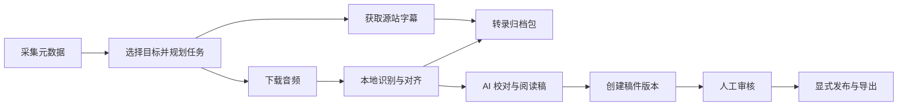

# Bilibili ASR Archive

把视频整理成可检索的转录档案和可审核的阅读稿。

本项目是一套 Python 命令行工具：采集 Bilibili 视频及分 P 元数据，获取源站字幕或下载音频，通过本地 Qwen3-ASR 识别和强制对齐生成转录，再按需进行 AI 校对、人工编辑和发布。显式创建的 `universal-v2` 归档还支持单个 YouTube 视频。

SQLite 保存元数据、转录版本、任务进度、失败尝试和审核历史；音频、字幕文件、阅读稿与网站内容都是可验证的文件产物。适合持续整理课程、访谈、长视频和多分 P 内容，也支持跨设备备份与恢复。

[快速开始](#快速开始) · [AI 校对与发布](#ai-校对与发布) · [搜索与导出](#搜索与导出) · [部署与运维](#部署与运维) · [完整文档](docs/README.md)

## 项目能力

| 环节 | 能做什么 |
| --- | --- |
| 元数据采集 | 按 UP 主分页采集视频、分 P、简介和标签，保留游标、刷新观察与失败记录 |
| 字幕与音频 | 获取源站人工 / AI 字幕，按候选策略读取正文；下载并登记音频及其 SHA-256 |
| 本地转录 | 使用 Qwen3-ASR 与 Qwen3-ForcedAligner，冻结配置、模型版本和输入，保存逐块诊断 |
| 转录归档 | 生成 SRT、WebVTT、TXT、Markdown、原始 JSON 和冻结的来源元数据，校验文件完整性 |
| AI 校对 | 使用 DeepSeek 或 OpenCode Go 整理阅读段落，保存独立修订、原文对照和疑点 |
| 人工出版 | 创建完整稿件版本，按内容哈希审核，显式发布与撤回，导出公开内容和草稿预览 |
| 查询与维护 | 元数据 / 转录搜索、覆盖率、完整性检查、JSON / CSV 导出、快照、显式升级与产物存储 |

## 工作方式



源站字幕采集与音频 → ASR 是独立的任务链。`--asr-policy all` 会为所选目标规划两条链；字幕失败不会阻止已有音频依赖的 ASR。`below-threshold` 根据已存储的质量评估决定是否规划 ASR，未知分数不会自动触发兜底。

任务规划对相同输入和配置保持幂等。worker 从数据库领取就绪任务，记录租约、执行尝试和结果；重试保留历史证据。ASR 配置在规划时冻结，修改环境变量不会改变已排队任务。

**转录归档包发布与阅读稿发布是两项操作。** `workflow publish` 生成转录文件；`publication publish` 发布已审核的稿件版本。AI 工作流只生成阅读稿与对照记录。

## 快速开始

以下命令在项目根目录执行。示例默认使用 `archive/`；换用其他归档时，为每个命令传入同一个 `--archive-root`。

### 1. 安装基础环境

需要 **Python 3.12+** 和 `uv`。仅采集元数据、搜索已有档案、运行 AI 校对或出版命令时，安装基础依赖即可：

```sh
uv sync --locked --inexact
```

激活项目环境后，可以直接使用下文的 `bili-asr` 命令：

| Shell | 激活命令 |
| --- | --- |
| PowerShell | `.\.venv\Scripts\Activate.ps1` |
| Linux / WSL / macOS | `source .venv/bin/activate` |

也可以不激活，使用 `uv run --no-sync bili-asr ...`。`--no-sync` 使用已安装的环境，避免命令运行前重新同步并移除单独安装的 GPU 依赖。

本地 ASR 另需 **与设备兼容的 PyTorch 运行时、识别与对齐模型，以及 PATH 中的 `ffmpeg` / `ffprobe`**。先安装并验证对应硬件的 PyTorch，再安装 ASR 依赖：

```sh
uv sync --locked --extra asr --inexact
```

项目将 `torch` 排除在 uv 依赖解析之外，由宿主机提供对应的 CUDA / ROCm 等构建；已有 GPU 环境同步依赖时使用 `--inexact`。生产部署按 [Miniconda 部署手册](docs/operations/miniconda-deployment.md)准备环境，AMD WSL 的具体步骤见 [ROCm GPU 手册](docs/wsl-rocm-gpu.md)。

### 2. 配置凭据和模型

[.env.example](.env.example) 列出了常用设置，**CLI 不会自动加载 `.env`**。需要在启动命令的 Shell 或进程环境中导出变量。下面是 PowerShell 示例，替换其中的值与模型路径：

```powershell
$env:BILI_SESSDATA = "你的 SESSDATA"
$env:BILI_ASR_MODEL = "C:\Models\Qwen3-ASR-1.7B-hf"
$env:BILI_ASR_ALIGNER_MODEL = "C:\Models\Qwen3-ForcedAligner-0.6B-hf"
$env:BILI_ASR_DEVICE = "cuda"
$env:BILI_ASR_LANGUAGE = "Chinese"
```

| 设置 | 用途 |
| --- | --- |
| `BILI_SESSDATA` | Bilibili 登录凭据；匿名元数据采集可不设，需要认证的字幕 / 音频操作应配置有效值 |
| `BILI_HTTP_PROXY` | 可选 HTTP 代理 |
| `BILI_ASR_MODEL` / `BILI_ASR_ALIGNER_MODEL` | 已准备好的识别与对齐 checkpoint；默认离线加载，文件缺失时会失败 |
| `BILI_ASR_DEVICE` / `BILI_ASR_LANGUAGE` | 执行设备与语言；设备默认 `cuda`，语言默认自动识别 |
| `DEEPSEEK_API_KEY` / `OPENCODE_API_KEY` | 可选 AI 校对服务密钥，按所选 endpoint 使用对应变量 |
| `BILI_ARTIFACT_ROOT` | 可选的独立产物目录；数据库仍保留在归档根目录 |

如需允许 Hugging Face 联网加载，规划任务时显式传入 `--no-offline`。生产环境建议准备本地 checkpoint，并固定识别模型和对齐器各自的 revision。凭据在运行时读取，不写入归档数据库或导出记录。

在 NVIDIA 环境先检查部署条件：

```sh
bili-asr check-asr-env --backend cuda
```

其他后端可显式选择 `rocm`、`hcu` 或 `amd-wsl`；省略参数时使用 AMD WSL 检查。部署检查通过只表示未发现已知阻塞，模型加载与识别仍需单独验证。探测、预热和就绪条件见 [ASR 部署检查](docs/operations/asr-deployment-readiness.md)。

AMD WSL 检查依次报告五个阶段：`dxg-detection`、`rocm-loader-path`、`torch-present`、`hsa-runtime` 和 `device-probe`，可据此定位设备映射、加载路径或运行时问题。

### 3. 创建归档并采集元数据

新项目可显式初始化当前通用归档。目标必须是新目录或空目录；已有归档直接使用，版本转换见 [显式升级](docs/operations/archive-upgrades.md)。

```sh
bili-asr archive init --target-root archive
bili-asr fetch-meta --mid 23191782 --limit-pages 2
bili-asr status
```

将 `23191782` 换成目标 UP 主的 UID；它也是当前 `--mid` 的默认值。`--limit-pages` 限制本次采集页数，默认 10 页。元数据采集不会自动规划转录任务。

重复执行 `fetch-meta` 会从已有游标继续；`--resume` 要求游标已存在。开始下一批前，程序会重新核对此前采集页的 BVID 顺序。新增投稿或列表变化导致 `metadata_resume_requires_reenumeration` 时，用 `--incremental` 从第 1 页重新发现：

```sh
bili-asr fetch-meta --mid 23191782 --limit-pages 2 --incremental
```

未显式初始化时，`fetch-meta` 仍可创建默认的 Bilibili 归档；它不会将已有库自动转换成 `universal-v2`。分页恢复、刷新策略和请求预算见 [来源采集说明](docs/guides/source-adapters.md)。

上游采集失败时，`fetch-meta` 返回退出码 2（exit 2）。限流记录为 `risk_interrupted` 并保留原游标；首次采集失败可能尚未生成游标，此时重新执行时省略 `--resume`。凭据被拒绝时先更新 `BILI_SESSDATA`，再重试。

### 4. 选择目标并执行转录

先用元数据搜索找到已采集视频的 BV 号，再将 `BV_EXAMPLE` 替换为真实值。本地 ASR 环境与模型应已准备好：

```sh
bili-asr search "视频标题关键词" --scope metadata --format json
bili-asr workflow plan --bvid BV_EXAMPLE --page-index 0 --asr-policy all
bili-asr workflow run --limit 20
bili-asr workflow status --jobs
bili-asr verify --format text
```

`--page-index 0` 对应源站 **P1**；省略时选择该视频所有可处理的分 P。也可以使用计划摘要中的内部 `video_part_id`，例如 `workflow plan --part-id 42`。`--bvid` 和 `--part-id` 支持重复选择，两种形式互斥，所有目标校验通过后才创建任务。

`workflow run` 执行就绪任务，默认运行至空闲后退出；`--limit` 限制执行的任务数，**不是视频数**。一次视频处理包含多个任务，达到限制后可再次执行。需要拆分采集、ASR 和校对进程时，使用 [worker 角色与监督器](docs/asr/asr-workers.md)。

完整参数见 [目标选择](docs/guides/workflow-selection.md) 与 [ASR 配置和诊断](docs/asr/asr-configuration.md)。

## AI 校对与发布

### 生成阅读稿

已有 ASR 转录后，配置校对密钥并创建任务。将示例 part ID 换成实际值：

```powershell
$env:DEEPSEEK_API_KEY = "你的 API 密钥"
bili-asr workflow proofread --part-id 42
bili-asr workflow run --only-editorial
```

默认使用 DeepSeek endpoint 与 `deepseek-flash`；OpenCode Go 的 endpoint、模型和密钥设置见 [AI 校对指南](docs/guides/ai-proofreading.md)。`proofread --part-id` 固定规划时最新的 ASR 版本及可用参考字幕；也可以用 `--base-transcript-id` 显式指定已有转录。使用 `workflow plan ... --proofread` 可将校对和渲染接到新 ASR 任务之后。

校对生成不可变修订，并渲染 `ai-draft.md` 与 `review.md`：前者是整理后的阅读稿，后者提供原文对照、来源时间、模型参数和疑点。更改输入或配置会创建新任务，重复相同计划复用已有结果。思考模式、推理强度、分块与输出预算可在规划时调整；实际服务用量保存在调用记录中。

### 人工审核并发布

从已渲染的 revision 创建完整稿件版本（edition），查看内容和 `content_sha256`，导出审核材料：

```sh
bili-asr publication create --revision-id REVISION_ID --actor EDITOR
bili-asr publication show --edition-id EDITION_ID --format json
bili-asr editorial export --revision-id REVISION_ID --edition-id EDITION_ID --out review-output
```

将 ID、操作者标识和哈希替换为实际值。审核者检查完整稿件后，针对该版本和准确哈希记录审核决定，再显式发布：

```sh
bili-asr publication review --edition-id EDITION_ID --status in-review --expected-status pending-review --content-sha256 CONTENT_SHA256 --actor REVIEWER --note "开始审核"
bili-asr publication review --edition-id EDITION_ID --status approved --expected-status in-review --content-sha256 CONTENT_SHA256 --actor REVIEWER --note "已核对此版本"
bili-asr publication publish --edition-id EDITION_ID --actor PUBLISHER
bili-asr publication export --out site-content
```

公开导出只包含每个处理单元的当前 release。已有文章保持发布状态，直到新版本获批并显式发布；修改正文会产生需要重新审核的新 edition。内部审核包与网站输入分别导出。

需要展示未发布稿件时，显式导出到另一个目录：

```sh
bili-asr publication export-drafts --out site-draft-content
```

预览保留稿件版本和审核标签，不产生 release。独立阅读站项目 `SuperCatQR/markdown-reading-site` 消费导出快照，本仓库的本地 `reading-site/` 检出目录被 Git 忽略。网站需支持所选导出契约；完整的编辑、撤回、版本检查和导出说明见 [稿件出版指南](docs/guides/publication.md)，跨视频阅读顺序见 [系列维护](docs/guides/publication-series.md)。

## 搜索与导出

元数据搜索直接读取已存储的标题、简介和标签。搜索转录前，显式构建派生全文索引：

```sh
bili-asr search "标题关键词" --scope metadata --format json
bili-asr search-index
bili-asr search "转录关键词" --scope transcripts --format json
bili-asr search "课程" --scope all --from 2026-01-01 --to 2026-12-31
bili-asr export --format csv --out archive/export.csv --with-text
```

搜索默认范围为 `transcripts`；`all` 在同一个结果上限内先返回元数据命中，再返回转录命中。日期按视频发布的 **UTC 日期**解释。范围和索引边界见 [元数据搜索指南](docs/guides/metadata-search.md)。

日常检查与故障定位：

```sh
bili-asr status
bili-asr runs --limit 10
bili-asr coverage --format json
bili-asr verify --format text
bili-asr workflow status --jobs --details
bili-asr workflow explain --job-id JOB_ID
bili-asr workflow asr-evidence --run-id RUN_ID --part-id 42
bili-asr dedup report --format text
```

`RUN_ID` 是 ASR 采集运行 ID，可从成功尝试结果中查得，区别于任务 ID。ASR 质量诊断用于发现已知风险，不等同于人工正确率评估。`dedup report` 展示相同音频对象或转录内容的精确复用。

状态、搜索、验证和导出读取已有兼容归档；缺失或不兼容的数据库会被拒绝。`search-index` 与 `search --rebuild` 是显式写索引的操作。

## YouTube 单视频接入

YouTube 需要 `youtube` 可选依赖、Deno 2.3.0+ 和 PATH 中的 `ffmpeg` / `ffprobe`。已有 ASR 环境同步时保留 `--inexact`，并按需同时选择所用 extras。

```sh
uv sync --locked --extra youtube --inexact
bili-asr source doctor
bili-asr archive init --target-root youtube-archive
bili-asr source import --archive-root youtube-archive --youtube VIDEO_ID_OR_URL
bili-asr workflow plan --archive-root youtube-archive --part-id PART_ID
bili-asr workflow run --archive-root youtube-archive
```

将输入替换为单个视频 ID / URL，`PART_ID` 使用 import 返回的内部 ID。本地 ASR 仍需前述运行时和模型。受限内容的后续 worker 可通过 `BILI_YOUTUBE_COOKIES` 读取私有 Netscape cookie 文件。

当前接入范围为单个视频，要求 `universal-v2` 归档；播放列表与直播不在此入口范围内。`source doctor` 检查本机依赖，在线可用性和账号授权需要在实际采集中验证。来源身份、字幕语言与迁移边界见 [来源适配指南](docs/guides/source-adapters.md)。

## 部署与运维

### 产物与存储

默认文件产物位于归档根目录。当前转录包包含六个数据成员与带 SHA-256 的 `archive-bundle-v3` 标记；已有 v2 包继续可读。AI 阅读稿和人工发布稿另有独立身份和目录。

从已存储的首选转录重建归档包，无需重新采集：

```sh
bili-asr workflow publish --part-id 42
bili-asr workflow run
```

`workflow run --artifact-root PATH` 或 `BILI_ARTIFACT_ROOT` 可将音频、转录包和文档写入独立的现有目录，`archive.db` 留在 `--archive-root`。规划与后续执行应使用一致的产物配置，详情见 [产物根目录](docs/operations/artifact-root.md) 和 [WebVTT / 转录包完整性](docs/guides/webvtt.md)。

音频默认保留；当前 workflow 不因 `BILI_KEEP_AUDIO=0` 自动删除音频。需要离线存储、复制或恢复时，使用显式的 [产物目录与卸载工具](docs/operations/artifact-storage.md)。自动存储策略须单独启用，规则和消费者恢复边界见 [音频保留策略](docs/operations/audio-retention-policy.md)。

### 备份与恢复

先停止归档写入进程，将快照保存到归档和产物目录之外，再校验并恢复到新目录或空目录：

```sh
bili-asr snapshot save --archive-root archive --out backups/bili-archive.zip
bili-asr snapshot check --file backups/bili-archive.zip
bili-asr snapshot restore --file backups/bili-archive.zip --archive-root restored-archive
bili-asr snapshot doctor --archive-root restored-archive
```

完整快照保存数据库、音频、转录包、阅读文档和文件哈希清单；恢复保留任务与审核历史，中断任务重新排队且保留原尝试。数据完整与运行环境就绪分别检查，目标机仍需配置凭据、模型和兼容的运行时。独立产物根、恢复计划和模型位置绑定见 [归档快照](docs/operations/archive-snapshots.md)。SSH 存储及声明外部依赖的引用备份见 [远程存储与引用备份](docs/operations/remote-reference-backups.md)。

### 故障与版本兼容

| 现象 | 处理入口 |
| --- | --- |
| 元数据恢复时发现列表顺序变化 | 使用 `--incremental` 重新发现，保留原游标与失败记录，见 [采集说明](docs/guides/source-adapters.md) |
| 字幕轨道存在但正文不可用 | 检查候选、上游正文和规范化证据；正文不可用不能据此判断音频静音，见 [字幕候选流程](docs/22-subtitle-candidates.md) |
| worker 空闲但仍有排队任务 | 查看 `workflow status --jobs --details` 与 `workflow explain` 的前置依赖 |
| ASR 模型缺失或设备不可用 | 核对离线 checkpoint、宿主 PyTorch 和冻结 profile，见 [部署检查](docs/operations/asr-deployment-readiness.md) |
| WebVTT 时间戳或转录包校验失败 | 保留原始转录和失败尝试，检查音频与对齐；修复原因后再明确重试，见 [完整性指南](docs/guides/webvtt.md) |
| 数据库或导出契约不兼容 | 停止写入并保留源归档，预检后向独立目标显式转换，见 [归档升级](docs/operations/archive-upgrades.md) |

取消和重试针对准确的任务 ID 操作。取消的任务不会因重复规划或 retry 自动复活；失败尝试和依赖阻塞保留在库中。具体行为见 [工作流取消](docs/guides/workflow-cancellation.md)。普通命令只验证已登记契约，打开归档不会隐式修改表结构。

## 开发与文档

源码入口：`src/bili_asr/cli/` 负责命令组合，`sources/` 负责平台适配，`services/` 负责业务编排，`storage/` 负责 SQLite 与持久契约；`asr/` 实现识别执行，工作流与出版模块维护任务及内容生命周期。

安装开发依赖并运行本地检查；已有 GPU 环境保留 `--inexact`，测试环境需提供 `ffmpeg`：

```sh
uv sync --locked --extra dev --inexact
uv run --no-sync ruff check src scripts tests --select E9
uv run --no-sync python -m compileall -q src tests scripts
uv run --no-sync python -m bili_asr.contracts --check-docs docs/contracts
uv run --no-sync pytest
```

真实网络测试需显式设置 `BILI_LIVE_SMOKE=1`，规模测试需设置 `BILI_SCALE=1`。CI 另执行依赖审计、安装包检查和覆盖率门禁，本地复现见 [CI 覆盖率说明](docs/development/ci-coverage.md)。

| 想了解什么 | 文档入口 |
| --- | --- |
| 所有功能与操作手册 | [完整文档索引](docs/README.md) |
| 当前结构、调用关系与数据所有权 | [系统架构](docs/architecture.md) · [流程与时序](docs/architecture-sequences.md) · [SQLite 数据参考](docs/metadata-storage.md) |
| 采集、搜索、校对和出版 | [使用指南](docs/guides/README.md) |
| ASR 配置、worker、性能与诊断 | [ASR 文档](docs/asr/README.md) |
| 部署、存储、迁移、备份与恢复 | [运维手册](docs/operations/README.md) |
| 来源简介、标签和历史产物补全 | [来源元数据](docs/guides/source-metadata.md) · [历史稿件简介补充](docs/guides/source-description-supplement.md) |
| 开发、契约与发布维护 | [开发与维护](docs/development/README.md) · [契约镜像](docs/contracts/README.md) |
| 固定日期与环境下的实际验证 | [实测记录](docs/evidence/README.md) |

## 许可证

本项目采用 **GNU GPL v3，仅限第 3 版（GPL-3.0-only）**，完整条款见 [LICENSE](LICENSE)。第三方组件遵循各自许可证；软件许可证不授予对所下载视频、音频、字幕或其他归档内容的权利。
