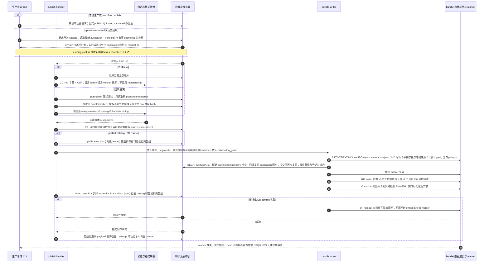

# 择优发布、锁定原转录回填与 bundle v3

源码基线：`0c62a0f511880e9d07bbf9505771ec15657995e7`；核对日期：2026-10-12（Asia/Hong_Kong）。

[交互时序图](08-transcript-bundle.html) · [Archify 规格](08-transcript-bundle.json) · [全部时序图](architecture-sequences.md)

## 调用顺序与条件分支

## 边界与恢复

- 转录 bundle 与获人工批准的 publication release 是两个独立发布域。
- archive.write_archive 支持较丰富的 ASR 参数；当前 workflow.publish 只传已观察到的子集，数据库证据用 workflow asr-evidence 查看。v3 raw JSON 保留转录/ASR 证据，不重复来源元数据；`bundle.md` 由规范 sidecar 和转录内容生成。
- 回填来源是当前数据库已存事实，不证明它等于旧发布时间的来源。普通 export 返回当前事实，已生成 bundle 保留发布时快照；无联网、音频下载、ASR 或 AI 调用。详细规划及回填见 [31](31-source-metadata-migration.md)。
- `artifact_json` 保留五个公开路径；sidecar 由 v3 marker 纳入精确文件集合和摘要核验。
- 受保护写锁解决合作取消/抢占竞态；不能保证掉电后数据库与文件恰好一次一致。

## 源码证据

- [src/bili_asr/storage/workflow.py:658](../src/bili_asr/storage/workflow.py#L658)：WorkflowRepository.request_publication。
- [src/bili_asr/workflow_runtime.py:411](../src/bili_asr/workflow_runtime.py#L411)：ArchiveWorkflowHandlers.publish。
- [src/bili_asr/services/transcript_projection.py:106](../src/bili_asr/services/transcript_projection.py#L106)：ordered_candidates。
- [src/bili_asr/services/transcript_projection.py:151](../src/bili_asr/services/transcript_projection.py#L151)：writer_segments。
- [src/bili_asr/storage/workflow.py:827](../src/bili_asr/storage/workflow.py#L827)：WorkflowRepository._terminal。
- [src/bili_asr/archive.py:888](../src/bili_asr/archive.py#L888)：write_archive。
- [src/bili_asr/archive.py:405](../src/bili_asr/archive.py#L405)：_publish_bundle。
- [src/bili_asr/archive.py:253](../src/bili_asr/archive.py#L253)：archive_bundle_complete。
- [src/bili_asr/services/artifact_groups.py:1](../src/bili_asr/services/artifact_groups.py#L1)：模块定义。

- [src/bili_asr/services/workflow_application.py:52](../src/bili_asr/services/workflow_application.py#L52)：普通 publish 与保留原转录的回填分派。
- [src/bili_asr/services/publication_refresh.py:28](../src/bili_asr/services/publication_refresh.py#L28)：publication_fence；发布时间、转录及有序 segments 绑定。
- [src/bili_asr/storage/metadata.py:175](../src/bili_asr/storage/metadata.py#L175)：read_source_metadata_export_many。

## 本次边界修复

生产和消费统一复用 `transcript_selection`。当前 preferred 与实际 published 分别展示，尚未发布的新偏好不会改写归档正文。发布事实的 published_at 是以墙钟秒为底的 part 内单调提交时间；同秒重发旧行也成为最新事实。短突发可能领先墙钟秒。共享 JobCommitGuard 在事务开始及提交前验证精确租约，失败时先使 marker 失效。
