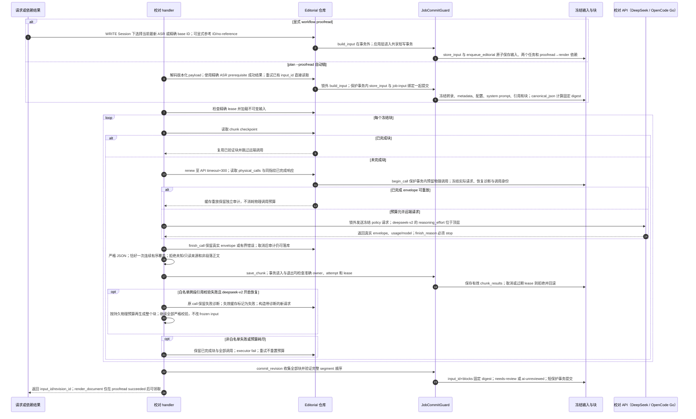

# 冻结 AI 输入、共享提交保护与逐块续跑

源码基线：`0c62a0f511880e9d07bbf9505771ec15657995e7`；核对日期：2026-10-12（Asia/Hong_Kong）。

[交互时序图](09-ai-proofread.html) · [Archify 规格](09-ai-proofread.json) · [全部时序图](architecture-sequences.md)

## 调用顺序与条件分支

## 边界与恢复

- build_input 在事务外构建冻结内容；显式请求的 store_input、两个任务和依赖边由应用层共事务保存，失败全部回滚。自动链的 store_input 与 job-input 绑定同样共用一次保护事务。
- Workflow 与 EditorialRepository 注入同一 JobCommitGuard；准确 attempt/owner/lease 在短写事务两端校验，不再各自实现租约保护逻辑。
- 来源覆盖证明结构追溯，不能证明模型语义保真；数字、专名、否定、立场仍需人工审核。供应商已收请求而本地未存时，仍可能重复计费；未完成预留计入累计预算，不因重启归还额度，不承诺外部恰好一次。
- canonical_json 是共享纯序列化契约；editorial.canonical/digest 保留兼容导出，持久 JSON、digest 和既有 schema 未改变。

## 源码证据

- [src/bili_asr/services/workflow_application.py:108](../src/bili_asr/services/workflow_application.py#L108)：WorkflowApplication.proofread。
- [src/bili_asr/workflow_payloads.py:92](../src/bili_asr/workflow_payloads.py#L92)：decode_job_payload。
- [src/bili_asr/editorial_runtime.py:46](../src/bili_asr/editorial_runtime.py#L46)：EditorialWorkflowHandlers.proofread。
- [src/bili_asr/storage/editorial.py:180](../src/bili_asr/storage/editorial.py#L180)：EditorialRepository.freeze_job_input。
- [src/bili_asr/storage/editorial.py:215](../src/bili_asr/storage/editorial.py#L215)：EditorialRepository.begin_call。
- [src/bili_asr/storage/editorial.py:347](../src/bili_asr/storage/editorial.py#L347)：EditorialRepository.finish_call。
- [src/bili_asr/storage/job_commit.py:13](../src/bili_asr/storage/job_commit.py#L13)：JobCommitGuard。
- [src/bili_asr/storage/editorial.py:144](../src/bili_asr/storage/editorial.py#L144)：EditorialRepository.store_input。
- [src/bili_asr/storage/editorial.py:418](../src/bili_asr/storage/editorial.py#L418)：EditorialRepository.save_chunk。
- [src/bili_asr/storage/editorial.py:423](../src/bili_asr/storage/editorial.py#L423)：EditorialRepository.commit_revision。
- [src/bili_asr/deepseek.py:110](../src/bili_asr/deepseek.py#L110)：DeepSeekClient.complete。
- [src/bili_asr/deepseek.py:149](../src/bili_asr/deepseek.py#L149)：parse_response。

## 当前冻结与失败恢复

v1/v2 输入按持久版本分派，普通 proofread 优先复用可验证冻结输入；refresh-input 显式建立新快照。结构性重复 ASR 输入在模型请求前失败；failed proofread 的新配置修复保留旧证据，见 [30](30-editorial-repair.md)。

新配置冻结 `request_policy=deepseek-v2` 与 `max_chunk_regenerations`（默认 2、可选 0–4），
预算为每个 input/chunk 最多 `1 + max_chunk_regenerations` 次物理调用。begin_call 在
租约保护短事务内计数并预留；失败、未完成发送和跨 job attempt 重试共同累计。
本地格式预检查和已完成响应重放分别记录调用类别，不消耗物理预算；缓存响应仍需
经过原严格校验，校验失败时原缓存标记为失败，避免无限重放坏响应。

仅 `cross_paragraph_reference` 属于当前恢复白名单，恢复策略为 `paragraph-reference-v1`。
诊断、前次 call、恢复序号和实际新请求持久化；模型重新生成整个 editable chunk，
全部原始 JSON/覆盖/顺序/引用规则继续校验。原始冻结来源、提示词和配置不被回写。
网络或不确定发送可以在剩余额度内重发原实际请求，但不伪造新的校验诊断。

deepseek-v2 enabled 模式使用顶层 reasoning_effort，thinking 只含 type；不发送 temperature。
disabled 不发送 reasoning_effort，发送有效 top_p=1 和可选 temperature（0–2）。
OpenCode Go 接收兼容请求形状，代码不证明代理实际遵守这些控制。缺少新字段的历史
snapshot 按 legacy-v1/零再生成解码，保留旧嵌套请求语义；显式新配置修复创建新身份。

新增源码证据：[请求策略分派](../src/bili_asr/deepseek.py#L35)、
[冻结配置的历史解码](../src/bili_asr/editorial.py#L143)、
[持久再生成策略](../src/bili_asr/editorial_recovery.py#L1)、
[块恢复与缓存重放](../src/bili_asr/editorial_runtime.py#L62)、
[物理调用预留与计数](../src/bili_asr/storage/editorial.py#L215)。

## 安全失败诊断与恢复准入

每一种响应校验失败都有有界 stage/reason、位置、计数和安全摘要。HTTP、网络、配置、解析与来源覆盖错误分别分类，状态默认不输出模型正文。冻结输入中的物理调用预算、缓存重放与白名单整块再生成继续按上述持久政策执行；workflow job 重排预算是另一项准入，不能重置已经消耗的模型调用额度。
普通 workflow retry 仍复用原冻结输入，需通过统一失败政策与显式 controls 检查；改变配置走 repair，新建输入与任务，保留原失败和模型调用。完整操作见[工作流失败恢复](operations/workflow-failures.md)与[流程33](33-workflow-failure-recovery.md)。
