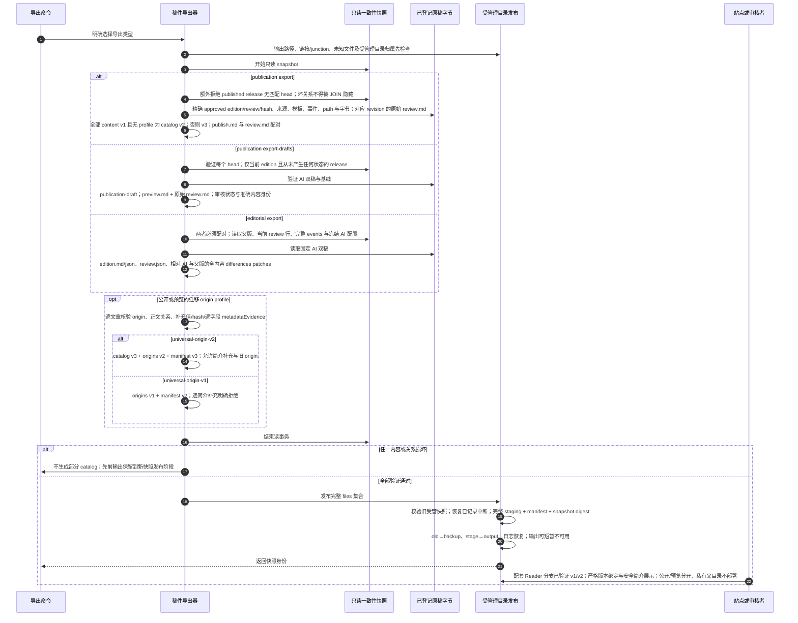

# 公开、未发布预览与私有审阅三种导出

源码基线：`3ed823c961736378d8408bba5f0535b03e0046e0`；核对日期：2026-10-12（Asia/Hong_Kong）。

[交互时序图](12-reader-private-export.html) · [Archify 规格](12-reader-private-export.json) · [全部时序图](architecture-sequences.md)

## 调用顺序与条件分支

## 边界与恢复

- 读者 review.md 是 AI 初稿的原文与疑点参照，不是人工审核记录；编辑后的正文可能与它不同。
- 公开/预览均不包含 actor、审核 events、请求配置与私有差异；私有包始终另行显式导出。
- withdraw 修改 DB head；已导出或已部署副本需要再次导出和刷新，本仓库不自动发布远端站点。

## 源码证据

- [src/bili_asr/cli/publication.py:63](../src/bili_asr/cli/publication.py#L63)：_cmd_publication。
- [src/bili_asr/cli/editorial.py:14](../src/bili_asr/cli/editorial.py#L14)：_cmd_editorial。
- [src/bili_asr/publication_export.py:91](../src/bili_asr/publication_export.py#L91)：export_publications。
- [src/bili_asr/publication_export.py:148](../src/bili_asr/publication_export.py#L148)：export_publication_drafts。
- [src/bili_asr/publication_export.py:282](../src/bili_asr/publication_export.py#L282)：export_editorial。
- [src/bili_asr/publication_export.py:37](../src/bili_asr/publication_export.py#L37)：_read_snapshot。
- [src/bili_asr/publication.py:109](../src/bili_asr/publication.py#L109)：verify_release。
- [src/bili_asr/publication.py:1](../src/bili_asr/publication.py#L1)：模块定义。
- [src/bili_asr/export_snapshot.py:431](../src/bili_asr/export_snapshot.py#L431)：replace_snapshot。
- [src/bili_asr/publication_export.py:1](../src/bili_asr/publication_export.py#L1)：模块定义。

- [src/bili_asr/publication_export.py:234](../src/bili_asr/publication_export.py#L234)：_collect_origin，简介补充版本要求 universal-origin-v2。
- [src/bili_asr/publication_export.py:248](../src/bili_asr/publication_export.py#L248)：_add_origins 按 profile 分派 schema。

## 本次边界修复

CLI 使用 ArchiveSession 的 READ/WRITE 与 MANUSCRIPT 契约管理连接及维护锁；纯内容与身份规则由 publication_content / publication_identity / canonical_json 承载，历史字节身份保持原算法。读取快照经 storage.publication 的公开读/校验接口，不导入出版编排函数。

## 当前版本与消费

content v1/v2、publish/ai 模板按保存身份分派，导出先做 wheel 内离线 Schema 再核验真实引用/文件/hash。普通公开/预览与迁移 origin profile 分开；`--contract-profile universal-origin-v2` 支持新的简介补充证据，catalog v3/origins v2/manifest v3；旧 profile 仍按原严格 schema 验证，拒绝简介补充。新版来源信息不重写编辑摘要或正文，公开前仍需准确哈希审核和显式 publish。保留旧正文和来源补充见 [28](28-preserved-body.md)、[31](31-source-metadata-migration.md)，可选编辑系列见 [29](29-publication-series.md)。启用 catalog 后准确历史组可以显式恢复，不能用当前文件槽位代替旧版本。

阅读站配套独立分支 `codex/source-description-contract` 的提交
`4a5933c743a05d067ce719b63c04cb9dfbc5ab6c` 已实现并验证两组明确版本：
catalog 3/content 2/metadata 1 加 origins 1/manifest 2（v1）或 origins 2/manifest 3（v2）。
每份快照的 profile 与版本完整绑定；description 值、来源身份、hash 与 observedAt
交叉校验，拒绝混搭和降级。来源简介以转义的普通文本按需展示并保留换行，
与编辑摘要分开，null 和已知空字符串分别表达。184 个阅读站测试、真实生产者
v2 fixture 构建及 320/390/1440 像素浏览器检查通过；这是已验证的分支能力，
不表示已合并、上线或完成生产回填。
