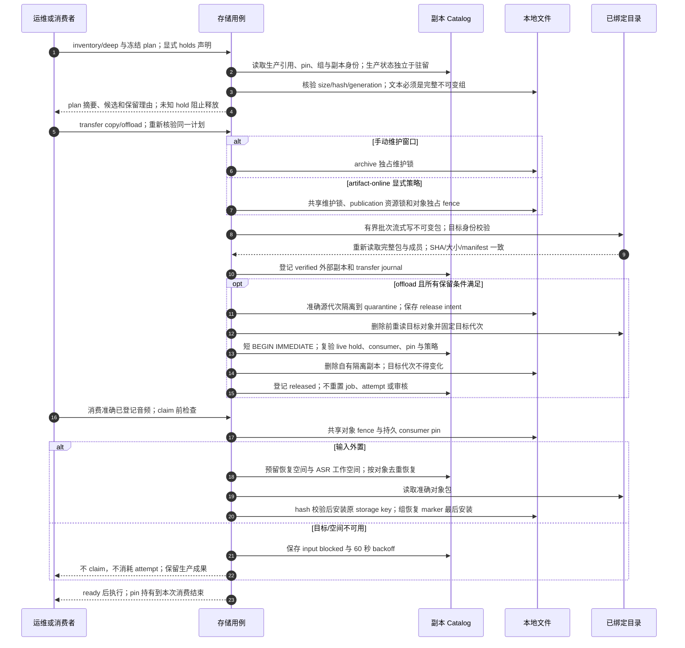

# 产物副本、迁出、消费 pin 与精确恢复

源码基线：`3ed823c961736378d8408bba5f0535b03e0046e0`；核对日期：2026-10-12（Asia/Hong_Kong）。

[交互图](24-artifact-storage.html) · [JSON 规格](24-artifact-storage.json) · [时序索引](architecture-sequences.md)

## 边界与恢复

- 生产完成、历史核验、副本驻留、目标可用性和本地 readiness 是不同事实。
- 在线策略默认 off；消费 pin 的释放由持有进程和内核锁证明，不能只按 lease/PID 超时猜测。
- SQLite/文件无跨介质事务；transfer 与 release journal 保留失败恢复证据。

## 源码证据

- [src/bili_asr/cli/artifacts.py:1](../src/bili_asr/cli/artifacts.py#L1)：模块定义。
- [src/bili_asr/services/artifact_transfer.py:286](../src/bili_asr/services/artifact_transfer.py#L286)：transfer_artifacts。
- [src/bili_asr/services/artifact_consumer.py:42](../src/bili_asr/services/artifact_consumer.py#L42)：candidate_artifact_access。
- [src/bili_asr/storage/artifact_catalog.py:186](../src/bili_asr/storage/artifact_catalog.py#L186)：ArtifactCatalog。
- [src/bili_asr/services/artifact_release.py:1](../src/bili_asr/services/artifact_release.py#L1)：模块定义。
- [src/bili_asr/services/artifact_groups.py:169](../src/bili_asr/services/artifact_groups.py#L169)：restore_artifact_group。
- [src/bili_asr/artifact_packages.py:1](../src/bili_asr/artifact_packages.py#L1)：模块定义。
- [src/bili_asr/storage_targets.py:1](../src/bili_asr/storage_targets.py#L1)：模块定义。
