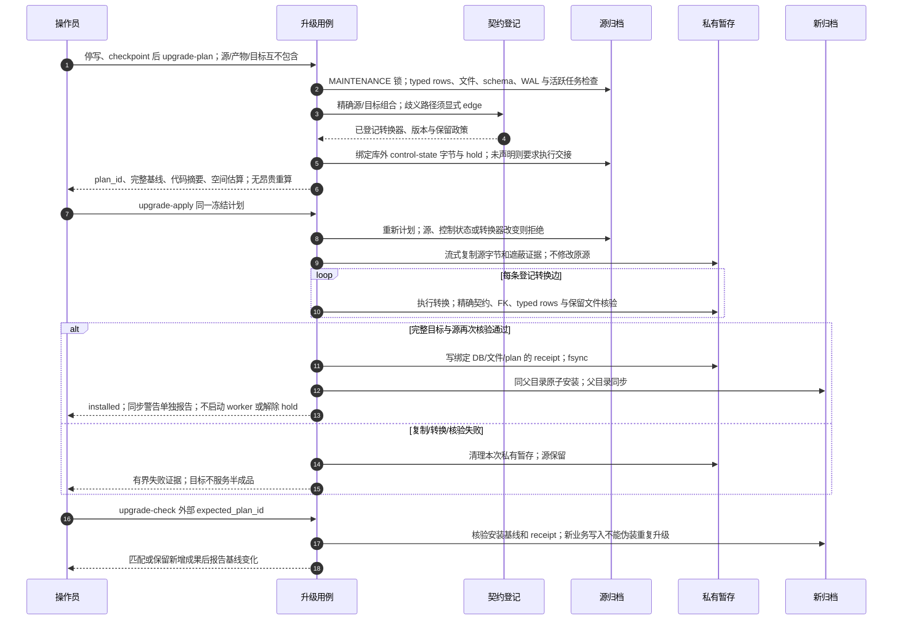

# 冻结契约路径、保真转换与新目标安装

源码基线：`0c62a0f511880e9d07bbf9505771ec15657995e7`；核对日期：2026-10-12（Asia/Hong_Kong）。

[交互图](25-contract-upgrade.html) · [JSON 规格](25-contract-upgrade.json) · [时序索引](architecture-sequences.md)

## 边界与恢复

- 版本数字不决定升级顺序，普通 READ/WRITE 不执行 DDL。
- 升级、interrupted-job recovery 和执行权交接是独立用例。相同成功基线可复用，运行后分叉不可自动合并。
- 完整快照自包含；引用备份仅保存可核验引用，见 27。

## 源码证据

- [src/bili_asr/cli/archive.py:1](../src/bili_asr/cli/archive.py#L1)：模块定义。
- [src/bili_asr/services/archive_upgrade.py:140](../src/bili_asr/services/archive_upgrade.py#L140)：plan_upgrade。
- [src/bili_asr/services/archive_upgrade.py:255](../src/bili_asr/services/archive_upgrade.py#L255)：apply_upgrade。
- [src/bili_asr/contracts/registry.py:336](../src/bili_asr/contracts/registry.py#L336)：upgrade_path。
- [src/bili_asr/services/archive_upgrade.py:73](../src/bili_asr/services/archive_upgrade.py#L73)：_inventory。
- [src/bili_asr/services/archive_upgrade.py:217](../src/bili_asr/services/archive_upgrade.py#L217)：_convert。
- [src/bili_asr/services/archive_upgrade.py:334](../src/bili_asr/services/archive_upgrade.py#L334)：check_upgrade。
