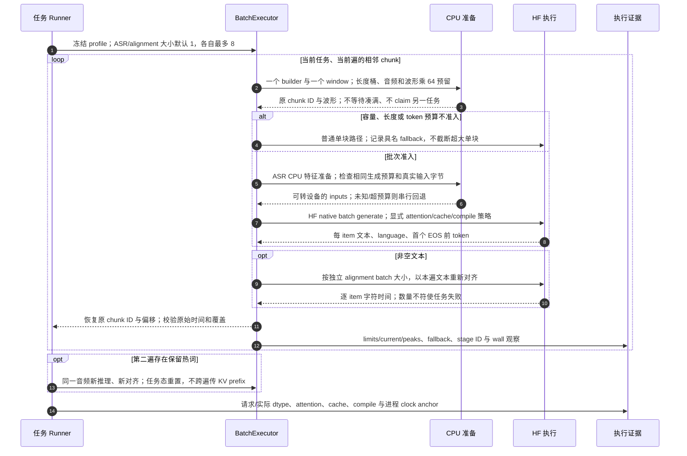

# 单任务有界批处理、原始对齐与策略证据

源码基线：`3ed823c961736378d8408bba5f0535b03e0046e0`；核对日期：2026-10-12（Asia/Hong_Kong）。

[交互图](26-asr-batching.html) · [JSON 规格](26-asr-batching.json) · [时序索引](architecture-sequences.md)

## 边界与恢复

- batch scheduler 拥有准备时禁用另一预取线程；同任务只有一个窗口和执行 stage。
- 预留约束附加准备工作，不是总 RSS/VRAM 硬上限；模型、KV、编译状态与其他进程在约束之外。
- CUDA Graph runner 未启用。可选策略保留 fallback 证据，wall 事件不能相加当 kernel 时间。

## 源码证据

- [src/bili_asr/asr/runner.py:214](../src/bili_asr/asr/runner.py#L214)：ASRRunner。
- [src/bili_asr/asr/batching.py:31](../src/bili_asr/asr/batching.py#L31)：BatchExecutor。
- [src/bili_asr/asr/preparation.py:1](../src/bili_asr/asr/preparation.py#L1)：模块定义。
- [src/bili_asr/asr/backend.py:1](../src/bili_asr/asr/backend.py#L1)：模块定义。
- [src/bili_asr/asr/strategies.py:22](../src/bili_asr/asr/strategies.py#L22)：RuntimeStrategies。
- [src/bili_asr/asr/execution.py:88](../src/bili_asr/asr/execution.py#L88)：execution_policy。
