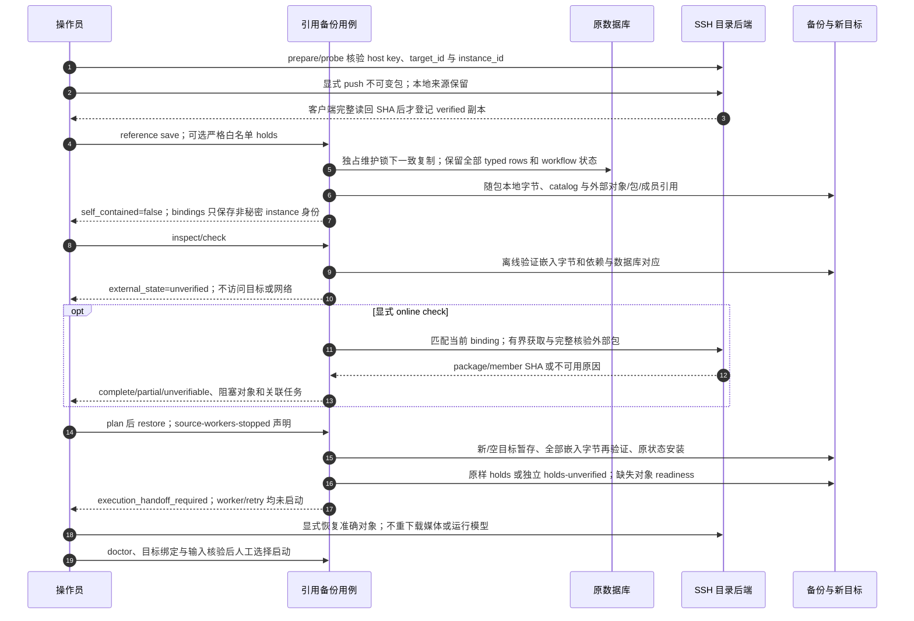

# SSH 精确包与非自包含引用备份的执行交接

源码基线：`3ed823c961736378d8408bba5f0535b03e0046e0`；核对日期：2026-10-12（Asia/Hong_Kong）。

[交互图](27-reference-backup.html) · [JSON 规格](27-reference-backup.json) · [时序索引](architecture-sequences.md)

## 边界与恢复

- 引用备份不承诺外部副本当前在线；离线检查永不升级为完整快照。
- 当前远程上传始终保留本地源，不启用远程自动删除。SSH 地址与凭据只属于本次 binding。
- 停止源 worker 的声明不自动终止进程；恢复不清 retry holds，不合并分叉数据库。

## 源码证据

- [src/bili_asr/cli/remote_storage.py:1](https://github.com/SuperCatQR/bilibili-asr-archive/blob/3ed823c961736378d8408bba5f0535b03e0046e0/src/bili_asr/cli/remote_storage.py#L1)：模块定义。
- [src/bili_asr/services/reference_backup.py:1](https://github.com/SuperCatQR/bilibili-asr-archive/blob/3ed823c961736378d8408bba5f0535b03e0046e0/src/bili_asr/services/reference_backup.py#L1)：模块定义。
- [src/bili_asr/storage/artifact_catalog.py:1](https://github.com/SuperCatQR/bilibili-asr-archive/blob/3ed823c961736378d8408bba5f0535b03e0046e0/src/bili_asr/storage/artifact_catalog.py#L1)：模块定义。
- [src/bili_asr/services/remote_artifacts.py:1](https://github.com/SuperCatQR/bilibili-asr-archive/blob/3ed823c961736378d8408bba5f0535b03e0046e0/src/bili_asr/services/remote_artifacts.py#L1)：模块定义。
- [src/bili_asr/remote_storage.py:1](https://github.com/SuperCatQR/bilibili-asr-archive/blob/3ed823c961736378d8408bba5f0535b03e0046e0/src/bili_asr/remote_storage.py#L1)：模块定义。
- [src/bili_asr/services/reference_backup.py:348](https://github.com/SuperCatQR/bilibili-asr-archive/blob/3ed823c961736378d8408bba5f0535b03e0046e0/src/bili_asr/services/reference_backup.py#L348)：restore_reference_backup。
