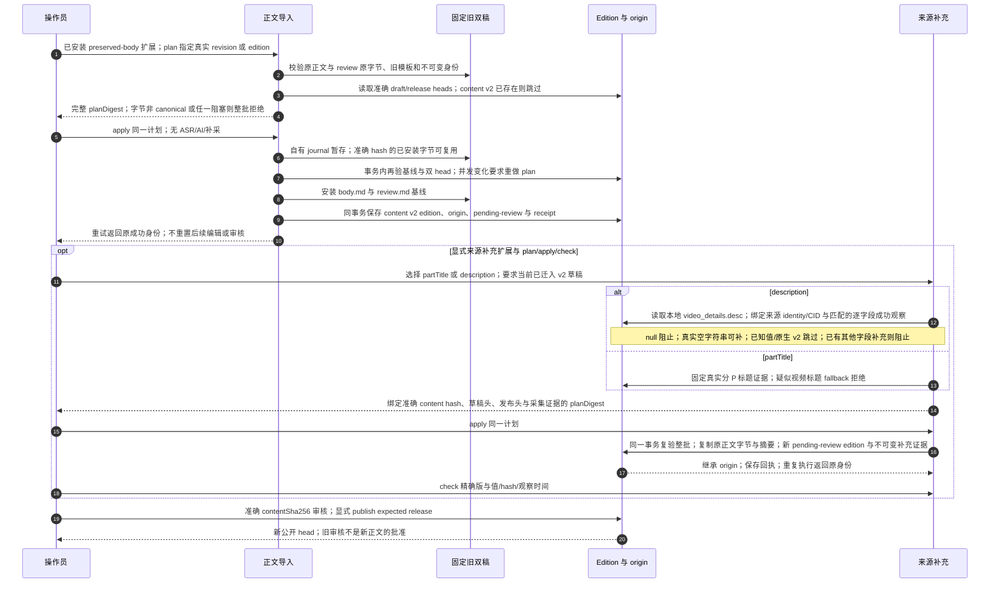

# 保留旧正文、来源补充与重新审核

源码基线：`378f415ac5bf2a47de9137ee593f201e86827d43`；核对日期：2026-10-11（Asia/Hong_Kong）。

[交互图](28-preserved-body.html) · [JSON 规格](28-preserved-body.json) · [时序索引](architecture-sequences.md)

## 边界与恢复

- legacy-frozen-facts-v1、标题补充、简介补充是独立政策；未知旧来源字段保持 null/unobserved。简介用 `legacy-description-supplement-v1`、version 2 supplement 与 `archive-video-details-projection`。
- 简介补充保留正文 UTF-8 字节、标题、编辑摘要和文章标签；原 AI artifact、旧 edition 与旧 release 保存。新版本仍须重新审核、显式 publish。
- observedAt 只取匹配 value_json 的简介逐字段 last_success_at；无证据为 null，后来采集失败保留成功证据；详情整行时间不能代替简介时间。
- 正文改动后 origin relation 为 derived，等于基线为 preserved；快照保留全部原参照。
- 普通保留正文/标题补充稿可用 universal-origin-v1：catalog v3/origins v1/manifest v2；简介补充必须用 universal-origin-v2：catalog v3/origins v2/manifest v3。旧 profile 明确拒绝新简介证据；当前阅读站只消费旧 profile。
- 不支持多字段补充链；已补 partTitle 的文章不能再补 description。整批身份或采集事实改变则回滚，重新生成计划。完整回填顺序见 [31](31-source-metadata-migration.md)。

## 源码证据

- [src/bili_asr/cli/publication.py:1](../src/bili_asr/cli/publication.py#L1)：模块定义。
- [src/bili_asr/services/preserved_body_import.py:132](../src/bili_asr/services/preserved_body_import.py#L132)：plan_preserved_body_import。
- [src/bili_asr/services/preserved_body_import.py:237](../src/bili_asr/services/preserved_body_import.py#L237)：apply_preserved_body_import。
- [src/bili_asr/services/import_staging.py:1](../src/bili_asr/services/import_staging.py#L1)：模块定义。
- [src/bili_asr/storage/import_origins.py:1](../src/bili_asr/storage/import_origins.py#L1)：模块定义。
- [src/bili_asr/services/source_supplement.py:53](../src/bili_asr/services/source_supplement.py#L53)：plan_source_supplement。
- [src/bili_asr/services/source_supplement.py:169](../src/bili_asr/services/source_supplement.py#L169)：apply_source_supplement，整批复验及 pending-review 子版。
- [src/bili_asr/services/source_supplement.py:39](../src/bili_asr/services/source_supplement.py#L39)：check_source_supplement。
- [src/bili_asr/storage/source_supplements.py:70](../src/bili_asr/storage/source_supplements.py#L70)：capture_description，真实已存值与逐字段采集时间。
