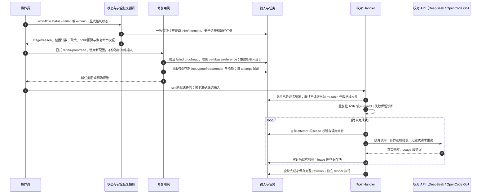

# 冻结失败诊断、显式修复与输入重用

源码基线：`813982215dab490ca462f991a5b440bd2ef19621`；核对日期：2026-10-12（Asia/Hong_Kong）。

[交互图](30-editorial-repair.html) · [JSON 规格](30-editorial-repair.json) · [时序索引](architecture-sequences.md)

## 边界与恢复

- 旧 failed attempt、请求与冻结身份保留；修复不是偷偷改旧配置再 retry。
- 冻结输入的合法重用保持来源哈希与版本，升级后不应重复 ASR/AI 来制造新身份。
- 结构校验失败可人工检查后用原冻结输入重试，或明确改变配置建立修复任务；源重复需要先复核/纠正转录。
- 状态不回显原响应；旧错误码与缺失诊断保持可读/未知。完整状态和重排决定见 [失败恢复](operations/workflow-failures.md)。

## 源码证据

- [src/bili_asr/cli/workflow.py:1](../src/bili_asr/cli/workflow.py#L1)：模块定义。
- [src/bili_asr/services/editorial_repair.py:12](../src/bili_asr/services/editorial_repair.py#L12)：repair_proofread。
- [src/bili_asr/storage/editorial.py:36](../src/bili_asr/storage/editorial.py#L36)：EditorialRepository。
- [src/bili_asr/storage/workflow.py:39](../src/bili_asr/storage/workflow.py#L39)：WorkflowRepository。
- [src/bili_asr/editorial_runtime.py:1](../src/bili_asr/editorial_runtime.py#L1)：模块定义。
- [src/bili_asr/deepseek.py:1](../src/bili_asr/deepseek.py#L1)：模块定义。
