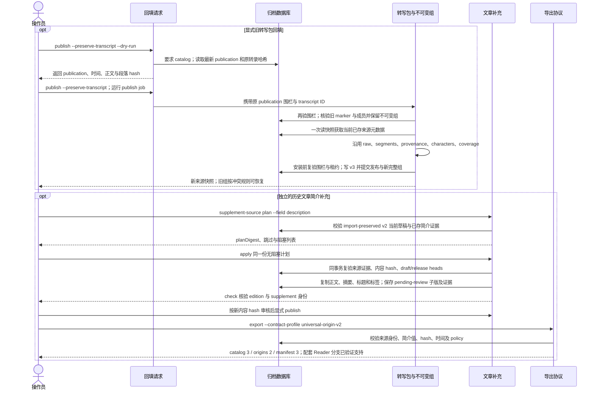

# 来源回填：旧转写包与旧文章

源码固定于 `0c62a0f511880e9d07bbf9505771ec15657995e7`，2026-10-11 核对。
交互版：[来源回填流程图](31-source-metadata-migration.html)，可编辑源：[JSON](31-source-metadata-migration.json)。

两种操作分别显式执行。旧包回填更新来源快照，锁定原来实际发布的转录；旧文章补充生成新的待审版本。普通 JSON/CSV 导出读取当前数据库来源信息，文章和 bundle 则保存各自版本的快照。

旧包回填必须已有 artifact catalog；没有时可先用 `artifacts upgrade` 将原 archive 保真升级到独立新目录。规划围栏绑定原 publication、发布时间、原转录与有序段落哈希；执行时从当前数据库读取元数据，不把来源值固定在 dry-run 时刻。worker 保存旧包完整组并核验原 raw 对象，安装前再次检查围栏与租约。旧包不完整、哈希不符或请求已陈旧均拒绝，不覆盖损坏事实。此链路只运行 publish，无需网络、音频下载、ASR 或 AI。

文章补充只支持已经 `import-preserved`、简介仍为 `null` 的历史 v2 当前草稿。原生 v2 和已有简介的版本跳过；本地简介未知、已有另一字段补充证据或任一计划阻塞项会阻止执行。真实空字符串是已知简介，可以补入。简介时间只取逐字段成功采集记录中与 `value_json` 匹配的 `last_success_at`；缺少这项证据时为 `null`。详情行更新时间与补充注册时间均不能代替它。

`apply` 对整批来源证据、当前正文身份和双头执行事务核对；冲突要求重新规划，同一成功计划重试返回原回执。新版本保存原正文 UTF-8 字节和编辑摘要，保留旧 release、原 AI 双稿及审核记录；随后仍需按新版本重新审核并显式发布。符合未发布条件的新版也可通过 `export-drafts` 预览。

简介补充必须导出为 `universal-origin-v2`：catalog 为 3、origins 为 2、manifest 为 3，`source-metadata-v1` 保持原协议。旧 `universal-origin-v1` 继续使用 origins 1 / manifest 2，并拒绝简介补充。阅读站配套独立分支 `codex/source-description-contract` 提交 `4a5933c743a05d067ce719b63c04cb9dfbc5ab6c` 已实现并验证 v1/v2 严格消费、来源简介纯文本展示与字段证据；保留换行、区分编辑摘要和未知/已知空简介。该分支不代表已合并或部署，操作员仍需显式回填、审核、导出与部署，不能把代码验收作为生产迁移完成。

实现证据：

- [回填请求与 dry-run](https://github.com/SuperCatQR/bilibili-asr-archive/blob/0c62a0f511880e9d07bbf9505771ec15657995e7/src/bili_asr/services/workflow_application.py#L52)、[publication 围栏](https://github.com/SuperCatQR/bilibili-asr-archive/blob/0c62a0f511880e9d07bbf9505771ec15657995e7/src/bili_asr/services/publication_refresh.py#L28)。
- [publish worker](https://github.com/SuperCatQR/bilibili-asr-archive/blob/0c62a0f511880e9d07bbf9505771ec15657995e7/src/bili_asr/workflow_runtime.py#L419)、[保留旧完整组](https://github.com/SuperCatQR/bilibili-asr-archive/blob/0c62a0f511880e9d07bbf9505771ec15657995e7/src/bili_asr/services/artifact_groups.py#L120)、[批量来源投影](https://github.com/SuperCatQR/bilibili-asr-archive/blob/0c62a0f511880e9d07bbf9505771ec15657995e7/src/bili_asr/storage/metadata.py#L175)。
- [文章补充 plan](https://github.com/SuperCatQR/bilibili-asr-archive/blob/0c62a0f511880e9d07bbf9505771ec15657995e7/src/bili_asr/services/source_supplement.py#L53)、[事务 apply](https://github.com/SuperCatQR/bilibili-asr-archive/blob/0c62a0f511880e9d07bbf9505771ec15657995e7/src/bili_asr/services/source_supplement.py#L169)、[简介采集证据](https://github.com/SuperCatQR/bilibili-asr-archive/blob/0c62a0f511880e9d07bbf9505771ec15657995e7/src/bili_asr/storage/source_supplements.py#L70)。
- [导出 origin 校验](https://github.com/SuperCatQR/bilibili-asr-archive/blob/0c62a0f511880e9d07bbf9505771ec15657995e7/src/bili_asr/publication_export.py#L343)、[新 profile origin 文件](https://github.com/SuperCatQR/bilibili-asr-archive/blob/0c62a0f511880e9d07bbf9505771ec15657995e7/src/bili_asr/publication_export.py#L357)。
- [旧包回填操作](guides/source-metadata.md)、[旧文章补简介操作与支持范围](guides/source-description-supplement.md)。
