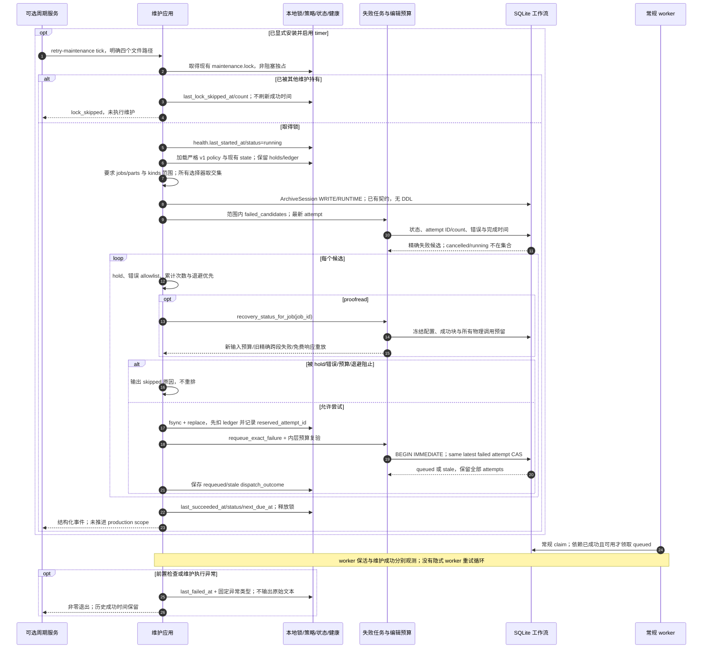

# 失败重试维护：周期接管、持久预算与独立健康

源码基线：`3ed823c961736378d8408bba5f0535b03e0046e0`；核对日期：2026-10-12（Asia/Hong_Kong）。本页描述该固定分支提交中的机制，部署交接另行执行。

[交互时序图](32-retry-maintenance.html) · [Archify 规格](32-retry-maintenance.json) · [运维交接手册](operations/retry-maintenance.md) · [全部时序图](architecture-sequences.md)

## 调用顺序与条件分支

## 边界与恢复

- 这是可选部署入口。仓库提供 service/timer/env/policy 示例；代码合并不等于生产 timer 已启用。既有生产维护脚本须按交接手册移除旧的无筛选重排循环，并继续使用同一个现有锁。
- policy v1 要求精确 job/part 选择和显式 kind，每类有独立允许错误列表；不能扫描全部 failed 后直接调用通用 requeue_failed。双 selector 为交集，各自最多 400 项。
- 首次重试退避从最新失败 attempt.finished_at 起算；后续按累计 ledger.last_retry_at 起算。缺失 ledger 条目不能将首次延迟误算成自 Unix epoch 起已满足。
- state.json 必须已经存在且含 reviewed retry_holds/retry_ledger；缺失、未知字段结构、无效预算或重复 JSON 键都会拒绝执行。已有 holds、累计 retry 数和其他运维字段原样保留，不创建一个空 state 替代历史证据。
- 来源观察中的 advisory 错误类别不代表静音。subtitle_body_unavailable、发布时间戳/质量契约失败、cancelled、未知错误和费用失败都不在自动 allowlist。
- DeepSeekTransportError 只来自 requests.RequestException；HTTP 402、解析错误和历史泛化 DeepSeekError 需要诊断。proofread 无论何种允许错误，都复验持久物理预算；unfinished 调用也计数。
- 旧 proofread 冻结输入不被升级：严格校验保存响应证明精确跨段引用错误时，可在既有 job ledger 下重发原请求；再生成只属于新输入冻结策略。合法已保存响应可免费重放。预算耗尽不能由重排 job 重置。
- 外部 state 文件与 SQLite 不构成一个事务。先 durable charge，再 latest-attempt CAS；崩溃最多损失一次 allowance，不能获得免费 retry。若旧 attempt 仍 failed，reserved_attempt_id 相同会报告 reservation_requires_review。人工复验保留证据后决定下一步，不自动退款。
- CAS 在短事务内复验状态、attempt_count、错误、最新 attempt_id/outcome/finished_at；中间有其他任务尝试或取消时返回 stale。attempt 历史保持原样，worker 自己按正常依赖规则领取。
- health 区分开始、成功、失败和锁竞争跳过，记录下一期时间。worker-health 只是独立快照，worker alive 不会让维护 healthy。health 命令在 stale/failed/never_succeeded 时非零退出；锁跳过不刷新 last_succeeded_at。
- policy/state/lock/health 文件不能互相别名或指向 archive.db；状态与健康写入使用临时文件、fsync 和原子 replace，不在 runtime 安装业务表或契约。

## 源码证据

- [scripts/deployment/bili-asr-retry-maintenance.timer](../scripts/deployment/bili-asr-retry-maintenance.timer)：可选一分钟周期服务。
- [src/bili_asr/cli/maintenance.py:11](../src/bili_asr/cli/maintenance.py#L11)：add_maintenance_parser/_cmd_retry_maintenance，健康先于数据库前置检查。
- [src/bili_asr/services/retry_maintenance.py:37](../src/bili_asr/services/retry_maintenance.py#L37)：RetryPolicy.load，严格范围与允许错误。
- [src/bili_asr/services/retry_maintenance.py:102](../src/bili_asr/services/retry_maintenance.py#L102)：maintain_failed_jobs，holds/预算/退避与 charge-before-CAS。
- [src/bili_asr/services/retry_maintenance.py:145](../src/bili_asr/services/retry_maintenance.py#L145)：tick，锁、开始/失败/成功健康、独立 ArchiveSession。
- [src/bili_asr/services/retry_maintenance.py:184](../src/bili_asr/services/retry_maintenance.py#L184)：health，worker 与维护独立判定。
- [src/bili_asr/services/retry_maintenance_io.py:16](../src/bili_asr/services/retry_maintenance_io.py#L16)：maintenance_lock 与生产 flock 兼容；write_json/update_health 为文件持久化边界。
- [src/bili_asr/storage/retry_maintenance.py:19](../src/bili_asr/storage/retry_maintenance.py#L19)：requeue_exact_failure，最新失败 attempt CAS，不删除尝试。
- [src/bili_asr/storage/editorial.py:270](../src/bili_asr/storage/editorial.py#L270)：recovery_status_for_job，冻配置与物理调用预算。
- [tests/test_retry_maintenance.py](../tests/test_retry_maintenance.py)：重启/锁竞争/精确尝试、历史跨段、新预算耗尽及真实 requests transport 与支付失败的离线集成验收。
