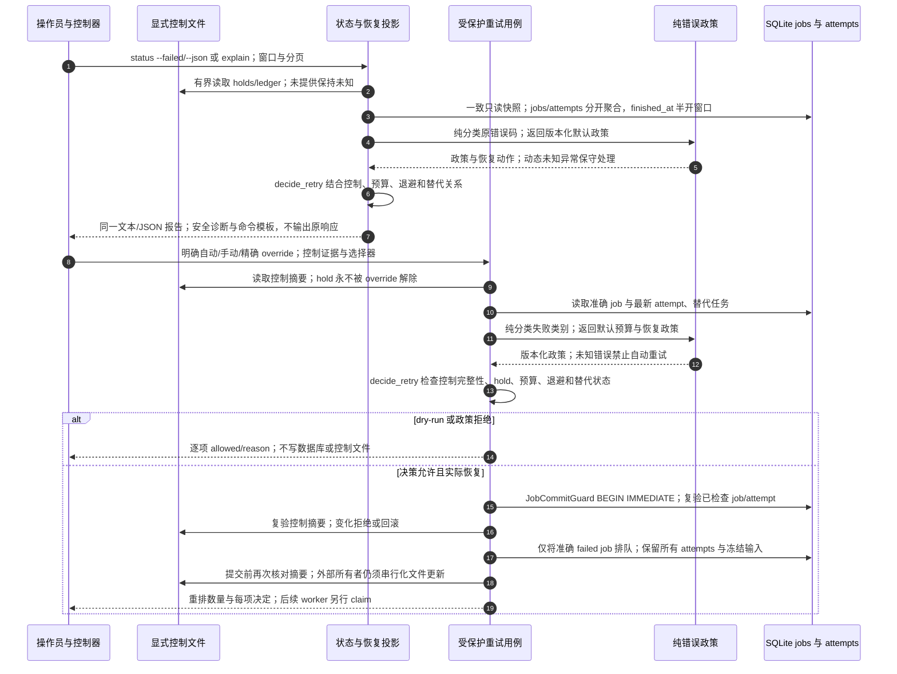

# 失败状态、政策决策与受保护重排

本流程补齐 #365–367 的观测与恢复边界；源码提交及图表 gate 见 [验证记录](architecture-validation.md)。
[交互图](33-workflow-failure-recovery.html) · [JSON](33-workflow-failure-recovery.json) · [操作手册](operations/workflow-failures.md)

## 数据与执行边界

- 当前失败 jobs、全部历史失败 attempts、窗口计数、holds 与替代任务是不同维度，不能相加。
- 外部控制未提供/不完整时不假定为空；明确不存在控制才能声明 no-control-state。
- 政策与诊断不替代人工来源或音频审核。修复旧校对建立新输入与链路，旧失败仍保留，见 [30](30-editorial-repair.md)。
- SQLite 与外部控制文件没有跨介质原子事务；摘要复验不能代替控制文件写入者的串行协调。
- 错误政策和查询不安装新 SQL；新 CLI/控制器使用统一用例，旧库级手动工具需要显式迁移调用点。

## 源码证据

- [workflow_failure_policy.py](../src/bili_asr/workflow_failure_policy.py)：纯分类与有限默认预算。
- [workflow_status.py](../src/bili_asr/services/workflow_status.py)：安全状态投影与恢复模板。
- [workflow_retry.py](../src/bili_asr/services/workflow_retry.py)：控制证据、决定和事务复验。
- [storage/workflow_status.py](../src/bili_asr/storage/workflow_status.py)：只读事实和分组。
- [storage/workflow_retry.py](../src/bili_asr/storage/workflow_retry.py)：准确快照及写入边界。
