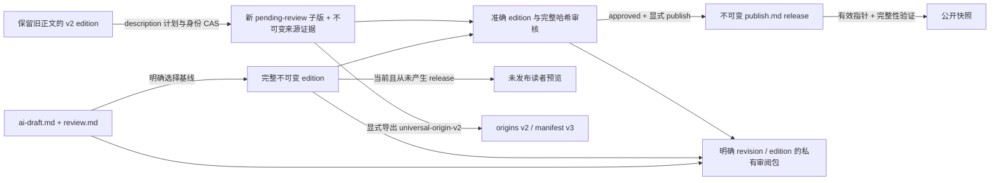

# AI、完整版本与出版架构

当前核对源码 `0c62a0f511880e9d07bbf9505771ec15657995e7`；2026-10-12（Asia/Hong_Kong）。[交互图](ai-proofreading-architecture.html) · [JSON](ai-proofreading-architecture.json)。完整版本与来源政策见[当前架构](architecture.md)，调用过程见[33 个时序](architecture-sequences.md)。

当前输入/content v1/v2 与模板按保存版本分派；导出先校验 wheel 内 Schema，再核验真实来源、revision、引用、文件集合与 hash。冻结输入重用和显式失败修复见 [30](30-editorial-repair.md)；保留旧正文、immutable origin 和来源补充见 [28](28-preserved-body.md)；bundle 回填与文章简介补充的两条操作链见 [31](31-source-metadata-migration.md)；编辑确认系列见 [29](29-publication-series.md)。artifact catalog 使准确历史双稿可保留/恢复，生产状态与驻留分开。

## 目标与主链路

校对把口述字幕整理为语句、逻辑通顺的阅读稿。允许清理无意义口头语、重复和半句重启，
合并跨字幕句子、调整局部语序；保留观点、论据、例子、因果和转折，不摘要、不扩写。

1. 字幕采集与音频下载独立执行；ASR 只依赖音频，不依赖字幕存在或成功。
2. 两路转录分别保存来源明确的不可变版本。原始归档发布独立进行，不等待校对；新 bundle v3 独立冻结来源 sidecar。旧包回填用 `--preserve-transcript` 锁定原发布版本，保留原 ASR 证据。
3. 校对默认以 ASR 为基础，将当时可用的 CC / AI 字幕作为可选参考；固定实际版本、内容、视频元数据、提示词和配置。
4. 纯输入准备模块按时间交集关联字幕，按上下文和输出预算尽量使用大块；邻块上下文只读。
5. 按冻结 endpoint 与 request_policy 调用校对 API：新配置 deepseek-v2 在 enabled 下发送顶层 reasoning_effort，在 disabled 下发送 top_p=1 和可选 temperature；保留历史 legacy-v1 请求语义。远端调用前在租约保护短事务内持久预留物理调用预算。
6. 校验来源恰好覆盖一次且顺序不变、引用有效、正文结构正确；白名单跨段引用错误可在累计预算内重新生成整个块，全部严格规则继续执行。已完成响应可免费重放但仍须校验；取得任务所有权写锁后保存有效块，全部成功后受保护地提交完整修订。
7. 独立渲染任务生成纯正文 `ai-draft.md` 与原文对照 `review.md`，同 revision、按固定版本选择 `ai-draft-v1` 或 `ai-draft-v2`。重渲染不调用模型。
8. 明确创建完整 edition，冻结标题、正文、摘要、标签、来源、整理归属和编辑说明；任何读者可见变化产生新 edition。
9. 审核指定 edition、完整 SHA-256、预期状态和操作者；批准仍不公开，显式 publish 才生成 release 并切换公开指针。
10. 公开导出只读有效 release；未发布预览选择当前且从未产生任何 release 的 edition；私有导出明确选定 revision / edition，包含固定基线、完整版本、双差异和审核记录。

## 模块边界

| 模块 | 输入 | 输出与责任 |
| --- | --- | --- |
| 工作流控制 | 范围、策略、配置、持久化结果 | 计划、依赖、认领、租约、尝试与重试 |
| 字幕 / 音频 / ASR handler | 视频部分 ID、配置 | 独立来源的音频或转录；不调用校对 handler |
| 固定输入与分块 | 数据库转录版本、可选字幕、配置 | 不可变快照、稳定块 ID、参考引用、只读上下文；不依赖原始归档文件 |
| 兼容 Chat Completions 适配器 | 块、冻结提示词和参数 | JSON 段落候选；不写文档或调度任务 |
| 校验与提交 | 候选、固定基础片段、持久物理调用与诊断 | 严格校验、白名单有界再生成、有效块检查点与独立修订；重放不重新付费 |
| Markdown 渲染 | 已保存修订、模板 | ai-draft.md / review.md；纯排版、字节稳定 |

无状态指业务进度、输入选择和结果不依赖进程内存。客户端实例可以短期存在，重启后仍从 SQLite 恢复。
控制、原始转录、派生结果是同一数据库的逻辑分区，不是独立部署服务。

## 输入与修订契约

冻结主转录、可选参考、元数据、模型、规则、提示词和参数。重试不得重新选择最新版本。
默认 1M 上下文，输入预算 480,000，输出 262,144，安全预留 16,384。
UTF-8 字节数用于保守预算，输出估计包含思考、全文段落、ID 和疑点；实际用量保存 API usage。
每个基础片段恰好归属一个块；每个阅读段落关联连续的一组片段，段落整体按来源顺序排列。
跨段切开的“平 / 台”在合并段落中恢复为“平台”，不再保留字幕边界。

JSON 字段为 chunk_id、paragraphs；段落字段为 segment_ids、text、issues。
校验拒绝漏段、重复、乱序、未知来源、只读来源混入、无关证据和非纯段落正文。
结构覆盖只是来源追溯，不能证明模型保留了全部语义。数字、专名、否定、立场和引述归属不能猜改，
未确认疑点列入校对记录；疑点不回退整段，周围表达仍需通顺。

当前规则 `readable-prose-v2`；AI 模板与发布模板均按已登记的 v1/v2 身份分派。历史合法输入、内容和文件使用保存时的版本验证；未知 schema 或模板拒绝。新来源字段不修改旧 frozen input、旧 renderer 或旧 manifest 的定义。
相同快照和配置命中同一输入；参数或提示词改变生成新输入及任务。保存模型实际响应与最终修订，
已保存结果可确定性渲染，重新推理不能承诺文字一致。

新冻结配置记录 `request_policy=deepseek-v2` 和 `max_chunk_regenerations`（默认 2、范围 0–4）。
enabled 的 thinking 只含 type、reasoning_effort 位于请求顶层，temperature 不发送；
disabled 不发送 reasoning_effort，top_p=1，可显式 temperature（0–2）。OpenCode Go
使用同样的兼容形状，实际代理参数效果需另行实测。历史 snapshot 缺少新字段时按
legacy-v1/零再生成读取，不改变既有 input 身份或旧嵌套请求；新语义须显式创建新身份。

`paragraph-reference-v1` 仅恢复 `cross_paragraph_reference`：把有界诊断、前次 call
和恢复序号加入实际新请求，模型重生整个块后执行全部原校验。冻结 input 与来源保持
原字节，不能靠删疑点、换引用或放宽 validator 使块成功。额度绑定 input/chunk，
最多 `1 + max_chunk_regenerations` 个 provider 预留，跨进程和 job attempt 累计。

## 数据模型与文档

| 表 | 持久化内容 |
| --- | --- |
| workflow_jobs / workflow_attempts | 依赖、租约、尝试、结果与终态；复用现有调度器 |
| editorial_inputs / editorial_job_inputs | 不可变输入、分块、来源、配置、提示词及任务绑定 |
| editorial_model_calls | 所属尝试、实际请求及指纹、provider/replay/local 类别、物理预留、恢复策略与诊断、原响应、用量和错误；不存密钥 |
| editorial_chunk_results | 每块验证后的段落、source IDs、原文、时间与疑点 JSON |
| editorial_revisions | 完整派生修订、内容标识、ai-unreviewed / needs-review 状态 |
| document_artifacts | 修订、模板、路径和 SHA-256 |
| publication_editions | 完整不可变读者内容、父版、AI 来源及完整内容哈希 |
| publication_edition_reviews | 每个 edition 的当前准确内容哈希审核状态、审核人、意见和时间；历次变更追加到 events |
| publication_releases | 获批固定 publish.md、批准记录、内容 / 字节哈希、发布状态 |
| publication_heads | 分 P 的当前 edition 和当前有效 release 两个独立指针 |
| publication_events | 编辑、审核、批准、发布、替换和撤回的追加事实 |

阅读站不会直接连接数据库。`publication export` 以只读模式读取有效 release，验证精确批准关系、完整内容、
来源和文件哈希，公开或预览导出包含文章、配对的原始 `review.md` 和独立 manifest。全部文章为 content v1 且未选择 origin profile 时使用 catalog v2；含任一 content v2 文章或选择 origin profile 时使用 catalog v3。保留旧正文的迁移稿显式选择 origin profile；简介补充必须使用 `universal-origin-v2`，其 origins 为 v2、manifest 为 v3。旧 `universal-origin-v1` 的 origins v1/manifest v2 保持不变。
`publication export-drafts` 为当前且从未发布的 edition 输出同样配对的未发布快照。
校验参照公开每段原文、AI 整理稿、来源与时间、疑点、模型和采样参数；它针对 AI 初稿，不代表人工批准。
审核事件、操作者、请求配置、差异文件和完整审阅包仍另行私有导出。
损坏有效 release 或配对 AI 参照稿使整个导出失败。`editorial export` 明确选择 revision / edition，生成私有审阅包。
完整内容差异覆盖正文、标题、标签和说明；见 [契约说明](contracts/README.md)。

简介补充只读取本地 `video_details.desc`，复制旧正文、标题、摘要和文章标签，生成新的待审版本；不触发 AI 校对或重渲染旧双稿。`legacy-description-supplement-v1` 使用 version 2 证据和 `archive-video-details-projection` sourceKind。逐字段 `last_success_at` 必须与保存值匹配，缺少逐字段证据时采集时间为 null；详情整行时间不能代替简介时间。计划和 apply 均核验准确草稿头、发布头和来源身份，重复执行同一计划返回原回执，后续人工编辑继承证据。原生 v2 和已知简介不补，已有 partTitle 补充链明确阻止再补简介。阅读站配套分支 `codex/source-description-contract` 提交 `4a5933c743a05d067ce719b63c04cb9dfbc5ab6c` 已实现并验证 v1/v2 消费与安全简介展示；独立分支交付不代表已合并或部署，历史内容回填与重新审核发布仍须显式执行。

原始字幕和 ASR 不被覆写。通过来源 ID 追溯，不额外建立第二套调度或稀疏编辑表。
旧工作流类型约束不自动迁移，不删除现有数据库；需要支持新类型的归档库。
块结果立即保存，失败重试复用完成块。租约与尝试编号防止失效工作器提交。
供应商收到请求但本地未保存时退出，重试可能再次计费；未完成预留仍占累计物理额度。
完成但尚未提交块的响应按完整请求指纹重放、重新严格校验，不重复消耗物理预算。
坏缓存标记为失败防止重复重放，local_precheck 同样不占预算；不承诺外部调用恰好一次。

产物位于 documents/part-<ID>/<修订ID>/<固定模板版本>/。
ai-draft.md 仅含正文段落；无标题、目录、时间戳、脚注、链接或审核说明。
review.md 保存每段原文和整理稿、全部来源 ID、时间与回看链接、疑点、模型参数和版本，注明未经人工复核。
每份文件原子安装，相同修订与模板重新渲染字节一致。文本生成、完整双稿身份预检、
`stage_artifact` 临时文件写入与文件 fsync 在锁外；最终不可变安装、POSIX 目录 fsync 和双稿 artifact 登记共享租约保护写事务。
两文件不构成文件系统事务，失败可能保留第一份已写字节；读取方仍验证完整登记与固定内容。

`manuscript_templates.py` 固定 `AI_RENDERERS` 与 `PUBLISH_RENDERERS`。读取历史 artifact 按记录版本
重渲染并验证，不拿后来的 active writer 算法解释旧文件；未知版本拒绝，排版变化需要新模板、路径与身份。
当前已注册 v1/v2 AI 与 publication renderer；按保存版本验证历史字节。

`publication create` 从当前原始 `video_tags` 冻结 edition 标签；后续抓取不修改既有版本。
`publication sync-source-tags` 要求成功标签观察（包含成功空集合），以精确父版 CAS 创建新的 pending-review edition；
原有效 release 保持。标签 unavailable 保留旧原始集合，但不能视为本次刷新成功。

发布稿位于 `publications/part-<ID>/<releaseID>/<固定模板版本>/publish.md`，渲染完整获批内容。
A 发布后创建、请求修改、拒绝或批准 B 都保持 A；显式发布 B 才切换有效 release。
撤回清空公开指针，再次公开导出时移除旧文章，内部历史保留。OS 独占锁、完整 staging、恢复日志和目录切换
保证成功快照不混合版本；输出可能短暂不可用。输出与输入不重叠，链接、junction 和手工文件拒绝。
只部署输出目录，其父目录为私有恢复空间；已部署副本和缓存需与撤回同步刷新。

## 当前代码证据与验证

准确当前符号和行范围见本专题 JSON 的 sources，以及时序 09–12、28–31。完整图表验收见 [验证记录](architecture-validation.md)。

## 提交边界

CLI 经 WorkflowApplication 编排；显式校对的固定 input 与两个任务同一事务提交。自动校对先纯准备，再将 input 与 job binding 放入租约保护事务。双稿先在事务外编码、暂存、fsync，事务内仅安装、复验和登记。失败后已安装的不可变文件可作为未登记字节安全重试；数据库事务不能回滚文件。出版内容、来源身份、canonical JSON 使用独立纯契约模块，存储与快照不会反向调用出版用例。

编辑失败的响应解析与结构校验保存有界 stage/reason、位置和计数；状态不读取原响应正文。
配置、余额、源质量和模型输出错误不自动重试。重试仍用原冻结输入，修复创建新输入与
任务链；旧失败和 hold 保留，成功替代任务在报告中关联。明确外部控制、预算和事务复验
见 [失败恢复时序](33-workflow-failure-recovery.md) 和 [操作说明](operations/workflow-failures.md)。
