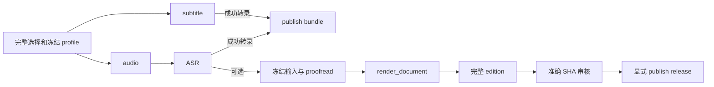

# 当前架构

本页与[全景图](architecture.html)、[AI/出版专题图](ai-proofreading-architecture.html)、[30 个时序流程](architecture-sequences.md)统一核对远端 main 的固定源码 **`4f073318c944add37417416155845e55247f9bc1`**，日期为 2026-10-11（Asia/Hong_Kong）。本地原 checkout 为 `effd9df473fca382133067eb1b7e04143ccbb849`；本轮在最新 main 的独立工作树核对。当前源码身份不会随远端后续提交自动变化。图的 JSON、HTML、SHA-256 与实际检查范围见[验证记录](architecture-validation.md)，完整命令/模块/数据库契约见[源码清单](architecture-sources.md)。

## 执行模型与责任

这是 Python CLI 和文件归档系统。SQLite archive.db 保存来源事实、不可变转录、workflow jobs/attempts、冻结输入、AI revision、完整 edition/review/release，以及显式安装的可选产物副本 catalog。音频、转录 bundle、稿件和证据保存为受限路径文件。没有独立 HTTP 应用服务、Redis 或外部队列；阅读站是外部消费者。

| 所有者 | 入口 | 责任 |
| --- | --- | --- |
| CLI 与访问生命周期 | cli/registry.py、parser.py、archive_session.py | 20 个顶层命令、86 条实际叶命令；文件/数据库模式与维护锁 |
| 来源适配 | sources/、source_registry.py、services/source_workflow.py | ContentRef、Bilibili 与 YouTube；访问、字幕候选、下载与观察证据 |
| 用例与控制 | services/workflow_application.py、workflow.py、storage/workflow.py | 纯依赖规划、冻结 profile、claim、heartbeat、attempt、cancel/retry、角色 worker |
| 推理执行 | workflow_runtime.py、asr/session.py、runner.py、backend.py | 父进程准确输入与提交；子进程模型和 HF 推理；准备、分块、真实对齐 |
| 编辑与出版 | editorial_runtime.py、storage/editorial.py、publication.py、publication_export.py | 固定输入、块检查点、完整 revision、双稿、edition/review/release 与三类出口 |
| 产物副本 | services/artifact_*、storage/artifact_catalog.py | 对象/完整组、包与副本、核验历史、保留条件、pin、容量预留与恢复 |
| 契约与维护 | contracts/、services/archive_upgrade.py、archive_snapshot.py、reference_backup.py | 版本/能力登记、离线 Schema、显式新目标升级、完整与引用备份、独立恢复 |

## 来源与生产链

universal-v2 使用 platform/external ID 与中立 source_video/source_creator；Bilibili 兼容字段保留，YouTube 的 bvid/cid 为 NULL。普通访问不会隐式将旧 bilibili-v1 改成通用库。来源 import 只建立事实与内部 part 身份，生产任务仍通过 workflow plan。

字幕与音频是独立 producer；ASR 仅依赖准确 audio 成功结果。候选字幕有数量、时间和请求预算；合法空正文、访问不可用和认证/absence 证据分别保存。Bilibili 字段刷新按观察与 TTL 判定，incremental head 发现不复用 resume cursor 为增量水位，必要详情/parts 重试受统一预算约束。见 [02](sequences/02-metadata-tags.md)、[05](sequences/05-subtitle-ingest.md)、[21](sequences/21-youtube-workflow.md)、[22](sequences/22-subtitle-candidates.md)、[23](sequences/23-metadata-refresh.md)。

## 准入、租约和进程

监督 executor 先 peek 精确 candidate，在 claim 前完成输入访问、对象 pin、精确恢复、空间预留和 GPU prepare/warmup；准备不创建 attempt。目标或空间不可用保存 readiness/backoff，任务不消耗 attempt。随后 expected_candidate claim；候选变化重新选择。成功认领后父进程持有 owner/attempt/expiry，独立连接 heartbeat；JobCommitGuard 在 BEGIN IMMEDIATE 后与 commit 前都复验。

每个 worker 顺序执行一个 job；supervisor 按角色和明确 slot 启动自有进程，drain 停止新领取并给活动任务宽限期。GPU 不访问数据库；IPC 绑定 generation/request/job/owner/attempt/profile/runtime binding。persistent 按完整配置和绑定复用模型，oneshot 成功后关闭，legacy 保留原隔离超时端口，CPU 无同等硬终止。取消、失租、超时或错身份响应不能提交；Linux 进程组、父死信号与 EOF Guardian 清理自有后代。见 [04](sequences/04-lease-cancel-retry.md)、[07](sequences/07-asr-runtime.md)、[19](sequences/19-persistent-asr.md)。

## ASR 准备、策略与证据

soundfile/ffmpeg RF64 解码为 mono 16 kHz float32，完整分块。HF 后端执行 ASR 与真实 ForcedAligner；每遍非空文本使用该遍波形/文本重新对齐，恢复原 chunk ID 和全局偏移。不插值、不排序或夹紧回退时间。保留第一遍证据支持的热词才运行第二遍；不跨任务或两遍传 KV prefix cache。

显式 profile 可选择 precision、attention、cache implementation、受限 compile、单层 CPU prefetch，以及单任务相邻 chunk 的独立 ASR/alignment batch。batch 大小默认 1，容量/长度/token/真实输入预算不满足则具名串行回退；不额外 claim，不等待凑满。batch 拥有准备时关闭另一预取线程。限制附加准备工作，不保证总 RSS/VRAM；CUDA Graph runner 未启用。运行策略、每块/遍诊断、EOS、原始对齐、coverage 与时钟锚点随本次证据保存；wall-time 不是 GPU kernel 利用率。见 [26](sequences/26-asr-batching.md)。

## 版本、bundle 与人工出版

转录按 CC/AI/ASR、语言 family、精确语言、版本总排序择优；preferred 与实际 published 身份分开。原始 bundle 不等待 AI。v2 为五个数据成员，v3 加 source-metadata.json；raw JSON 保留转录证据，来源 sidecar 独立。预编码/暂存/fsync 在短锁外，准确租约围栏内完成最终文件/marker 和发布事实。已安装 catalog 时覆盖前保存可验证旧完整组，并登记新组。见 [08](sequences/08-transcript-bundle.md)。

AI input/content v1/v2 与 ai-draft/publish 模板按保存版本读取；旧身份不因升级重算。合法冻结输入可重用，refresh-input 显式生成新输入。模型调用锁外执行，先审计真实响应，再做结构与 lease 校验；块检查点重试复用，完整 revision 之后独立渲染。重复性 ASR 输入 guard 在请求前失败，failed proofread 的显式修复保留原 attempt/input，见 [09](sequences/09-ai-proofread.md)、[10](sequences/10-document-render.md)、[30](sequences/30-editorial-repair.md)。

edition 保存完整读者内容；准确 content SHA 审核，显式 publish 才切公开 release head。source tags 刷新不会改旧 edition。保留旧正文导入不调用 ASR/AI，固定旧 body/review 原字节，产生 pending-review 的 content v2 与 immutable origin；来源标题补充是独立证据/政策。公开、从未发布预览、私有审阅分别核验身份与布局，迁移稿使用 universal-origin-v1；系列是另行人工确认的编辑元数据，按文件 SHA CAS，不推断关联。见 [11](sequences/11-publication-lifecycle.md)、[12](sequences/12-reader-private-export.md)、[28](sequences/28-preserved-body.md)、[29](sequences/29-publication-series.md)。

## 产物身份、驻留和副本

生产结果和本地文件存在不是同一状态。artifact-storage-v1 可选扩展保存对象摘要、不可变组、包、逻辑 target、replica generation、核验与 transfer/release journal；正常外置不将 job 变未完成，不清 attempts/review/release。真实 target 路径与 SSH 凭据只属于 invocation binding。默认读取不探测外部目标。

手动 transfer 在维护窗口执行；显式 artifact-online-v1 使用共享维护锁、资源/对象 fence、持久 consumer pin 与空间预留。策略默认 off，copy/offload 有水位、扫描/批次/IO/并发及 backoff；未知外部 hold、未成功消费者、pin、缺组、源或目标代次变化阻止释放。完整目标包读回核验后登记副本；删除前重读目标，在短写锁内复验 live hold/consumer/pin/政策。消费持有准确对象 pin 至结束，claim 前精确恢复，不重新下载媒体或跑模型补旧身份。见 [24](sequences/24-artifact-storage.md)。

## 契约、快照和恢复

contracts 注册 47 项稳定边界，wheel 发布 23 份离线 JSON Schema；docs/contracts 是原字节镜像。运行基础库、可选扩展和动态 FTS 分开登记。READ/WRITE 校验已有契约且不 DDL；archive init 仅空目标显式 bootstrap。upgrade-paths/plan/apply/check 使用精确组合和转换器摘要，在新目录保留 typed rows、rowid、冻结 JSON、全部历史文件及遮蔽证据，逐边核验后原子安装，保留源；不自动恢复任务、启动 worker 或解除 hold。库外控制状态需要单独交接。见 [25](sequences/25-contract-upgrade.md)。

完整 archive-snapshot/v1 从本地或准确外部包流式收集全部受支持文件、数据库和历史组，可显式无损压缩；恢复后不依赖旧 target。archive-reference-backup/v1 始终 self_contained=false，离线检查只验证嵌入数据和引用，online 才核验外部依赖。引用恢复保留原状态与 holds，始终要求执行权交接。SSH 目录上传必须核验 host key/instance 并完整读回 SHA，当前远程路径保留本地源。见 [15](sequences/15-archive-snapshot.md)、[20](sequences/20-recovery-plan.md)、[27](sequences/27-reference-backup.md)。

SQLite 与文件系统没有跨介质原子事务；marker、不可变 hash、journal 与显式 verify/recovery 识别失败。自动图检查不代替真实 API、GPU、付费 AI、生产升级或人工语义审核，历史测试记录保留原提交和日期。
