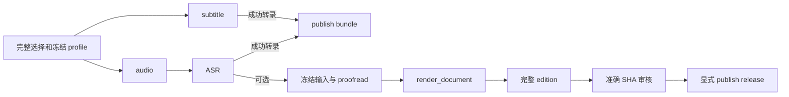

# 当前架构

本页与[全景图](architecture.html)、[AI/出版专题图](ai-proofreading-architecture.html)、[33 个时序流程](architecture-sequences.md)核对合并分支 `codex/workflow-failure-recovery` 的固定源码 **`96c5502119829119abce42a59804b79431895a98`**，日期为 2026-10-12（Asia/Hong_Kong）。本轮保留 Issue #349/#350/#361 实现并合并 #365/#366/#367 的失败恢复边界，并配合阅读站独立分支完成 #348 消费者支持；该身份表示分支实现，不能推断远端 main 已合并或生产已部署。图的 JSON、HTML、SHA-256 与实际检查范围见[验证记录](architecture-validation.md)，完整命令/模块/数据库契约见[源码清单](architecture-sources.md)。

## 执行模型与责任

这是 Python CLI 和文件归档系统。SQLite archive.db 保存来源事实、不可变转录、workflow jobs/attempts、冻结输入、AI revision、完整 edition/review/release，以及显式安装的可选产物副本 catalog。音频、转录 bundle、稿件和证据保存为受限路径文件。没有独立 HTTP 应用服务、Redis 或外部队列；阅读站是外部消费者。

| 所有者 | 入口 | 责任 |
| --- | --- | --- |
| CLI 与访问生命周期 | cli/registry.py、parser.py、archive_session.py | 21 个顶层命令、94 条实际叶命令；文件/数据库模式与维护锁 |
| 来源适配 | sources/、source_registry.py、services/source_workflow.py | ContentRef、Bilibili 与 YouTube；访问、字幕候选、下载与观察证据 |
| 用例与控制 | services/workflow_application.py、workflow.py、storage/workflow.py | 纯依赖规划、冻结 profile、claim、heartbeat、attempt、cancel/retry、角色 worker |
| 推理执行 | workflow_runtime.py、asr/session.py、runner.py、backend.py | 父进程准确输入与提交；子进程模型和 HF 推理；准备、分块、真实对齐 |
| 编辑与出版 | editorial_runtime.py、storage/editorial.py、publication.py、publication_export.py | 固定输入、块检查点、完整 revision、双稿、edition/review/release 与三类出口 |
| 产物副本 | services/artifact_*、storage/artifact_catalog.py | 对象/完整组、包与副本、核验历史、保留条件、pin、容量预留与恢复 |
| 契约与维护 | contracts/、services/archive_upgrade.py、archive_snapshot.py、reference_backup.py | 版本/能力登记、离线 Schema、显式新目标升级、完整与引用备份、独立恢复 |
| 有界失败维护 | cli/maintenance.py、services/retry_maintenance.py、storage/retry_maintenance.py | opt-in 周期 tick、独立健康、hold/ledger/backoff、准确失败 attempt CAS；不推进选择范围 |

## 来源与生产链

universal-v2 使用 platform/external ID 与中立 source_video/source_creator；Bilibili 兼容字段保留，YouTube 的 bvid/cid 为 NULL。普通访问不会隐式将旧 bilibili-v1 改成通用库。来源 import 只建立事实与内部 part 身份，生产任务仍通过 workflow plan。

字幕与音频是独立 producer；ASR 仅依赖准确 audio 成功结果。候选字幕有数量、时间和请求预算；合法空正文、访问不可用和认证/absence 证据分别保存。Bilibili 字段刷新按观察与 TTL 判定，incremental head 发现不复用 resume cursor 为增量水位，必要详情/parts 重试受统一预算约束。见 [02](02-metadata-tags.md)、[05](05-subtitle-ingest.md)、[21](21-youtube-workflow.md)、[22](22-subtitle-candidates.md)、[23](23-metadata-refresh.md)。

## 准入、租约和进程

监督 executor 先 peek 精确 candidate，在 claim 前完成输入访问、对象 pin、精确恢复、空间预留和 GPU prepare/warmup；准备不创建 attempt。目标或空间不可用保存 readiness/backoff，任务不消耗 attempt。随后 expected_candidate claim；候选变化重新选择。成功认领后父进程持有 owner/attempt/expiry，独立连接 heartbeat；JobCommitGuard 在 BEGIN IMMEDIATE 后与 commit 前都复验。

每个 worker 顺序执行一个 job；supervisor 按角色和明确 slot 启动自有进程，drain 停止新领取并给活动任务宽限期。GPU 不访问数据库；IPC 绑定 generation/request/job/owner/attempt/profile/runtime binding。persistent 按完整配置和绑定复用模型，oneshot 成功后关闭，legacy 保留原隔离超时端口，CPU 无同等硬终止。取消、失租、超时或错身份响应不能提交；Linux 进程组、父死信号与 EOF Guardian 清理自有后代。见 [04](04-lease-cancel-retry.md)、[07](07-asr-runtime.md)、[19](19-persistent-asr.md)。

## ASR 准备、策略与证据

soundfile/ffmpeg RF64 解码为 mono 16 kHz float32，完整分块。HF 后端执行 ASR 与真实 ForcedAligner；每遍非空文本使用该遍波形/文本重新对齐，恢复原 chunk ID 和全局偏移。不插值、不排序或夹紧回退时间。保留第一遍证据支持的热词才运行第二遍；不跨任务或两遍传 KV prefix cache。

显式 profile 可选择 precision、attention、cache implementation、受限 compile、单层 CPU prefetch，以及单任务相邻 chunk 的独立 ASR/alignment batch。batch 大小默认 1，容量/长度/token/真实输入预算不满足则具名串行回退；不额外 claim，不等待凑满。batch 拥有准备时关闭另一预取线程。限制附加准备工作，不保证总 RSS/VRAM；CUDA Graph runner 未启用。运行策略、每块/遍诊断、EOS、原始对齐、coverage 与时钟锚点随本次证据保存；wall-time 不是 GPU kernel 利用率。见 [26](26-asr-batching.md)。

## 版本、bundle 与人工出版

转录按 CC/AI/ASR、语言 family、精确语言、版本总排序择优；preferred 与实际 published 身份分开。原始 bundle 不等待 AI。当前普通发布和历史回填均生成 v3：SRT/VTT/TXT/MD/raw JSON 五个成员加 `source-metadata.json`，旧 v2 的五成员布局仍可读取和核验。`source-metadata-v1` sidecar 冻结发布时的来源信息；raw JSON 保留转录证据，来源 sidecar 独立。预编码/暂存/fsync 在短锁外，准确租约围栏内完成最终文件/marker 和发布事实。已安装 catalog 时覆盖前保存可验证旧完整组，并登记新组。见 [08](08-transcript-bundle.md)。

普通 JSON/CSV 导出从当前数据库批量读取简介、UP 主 ID/名称、标签、标签观察状态和详情采集时间；六个平铺字段也写入 bundle Markdown frontmatter。它们与严格的 `source-metadata-v1` 冻结快照分别保存：`video_details_observed_at` 不代表 UP 主名称或保留标签的共同采集时间，未观察到的标签状态保持 null。普通导出会保留简介里的普通链接，同时过滤凭据和签名媒体 URL；不为了导出重新访问来源。见 [13](13-projection-verify.md)。

旧 bundle 的简介回填先要求显式安装 artifact catalog；未安装时在独立新归档目录完成升级。`workflow publish --preserve-transcript --dry-run` 查看原 publication、transcript 与内容哈希，实际请求将这组身份入队。worker 核验旧 marker/成员字节并保存不可变完整组，复验 publication 围栏后用当前已存来源元数据生成 v3。转录、原 ASR provenance、coverage 和 character timing 保留，不下载音频或调用 ASR/AI；原 publication、发布时间、转录或有序 segments 的绑定身份改变时要求重新规划。见 [31](31-source-metadata-migration.md)。

AI input/content v1/v2 与 ai-draft/publish 模板按保存版本读取；旧身份不因升级重算。合法冻结输入可重用，refresh-input 显式生成新输入。模型调用锁外执行，先审计真实响应，再做结构与 lease 校验；块检查点重试复用，完整 revision 之后独立渲染。重复性 ASR 输入 guard 在请求前失败，failed proofread 的显式修复保留原 attempt/input，见 [09](09-ai-proofread.md)、[10](10-document-render.md)、[30](30-editorial-repair.md)。

## 失败政策、状态与恢复

`workflow_failure_policy.py` 是纯错误政策，storage 查询和受保护写入归属 repository 层，
`services/workflow_status.py` / `workflow_retry.py` 组合安全诊断、控制证据和操作决定，CLI 负责参数与渲染。
`workflow status` 的 failed 继续表示当前 jobs；历史失败 attempts、按 finished_at 的窗口、
按 kind/error 分组和活动替代任务独立显示，文本与 JSON 共用同一报告。
模型响应解析/结构校验保存 stage、reason、位置、计数和安全摘要，原响应只保留在调用证据。

holds 和 retry ledger 仍为显式提供的库外控制状态；缺失时不猜为空，完整自动资格显示未知。
自动重试只允许登记的 transient 错误，按数据库 attempts 下限检查预算、退避、holds 和替代任务。
worker 不新增内存重试循环；控制器调用统一 guarded_retry_failed 用例。
实际重排在 JobCommitGuard 的短写事务中复验 job、attempt 与控制摘要，hold/ledger 所有者仍须串行化文件更新。
精准人工 override 要求一个 job 与理由，不解除 hold。旧库级手动 requeue 能力保留，
部署控制脚本须显式迁移到新用例。源质量、余额/配置、模型契约和出版数据错误分别指向修复或人工检查。
三个新政策/投影契约不改基础 SQL、历史错误或冻结输入，见 [操作手册](operations/workflow-failures.md) 与 [33](33-workflow-failure-recovery.md)。

独立 `retry-maintenance` 周期维护保留其显式范围、allowlist、累计 ledger 和派发前扣减规则，见[流程32](32-retry-maintenance.md)。工作流观察/人工或自动重排接口与周期维护是两个入口；部署接管仍须停用旧 retry writer 并保留库外 controls。

edition 保存完整读者内容；准确 content SHA 审核，显式 publish 才切公开 release head。source tags 刷新不会改旧 edition。保留旧正文导入不调用 ASR/AI，固定旧 body/review 原字节，产生 pending-review 的 content v2 与 immutable origin；来源标题和简介补充使用各自的证据/政策。`supplement-source plan --field description` 只为已保留旧正文的 v2 文章计划补充；apply 在同一事务复验正文身份、草稿头、发布头和采集证据，创建 pending-review 子版，原正文 UTF-8 字节及编辑摘要保留。已补标题的文章不支持再串接简介，原生 v2 跳过；真实空简介可以补入，未知 null 会阻止计划。简介采集时间仅来自匹配值的逐字段成功观察，缺失则为 null。公开、从未发布预览、私有审阅分别核验身份与布局，简介补充稿要求 `universal-origin-v2`（catalog v3/origins v2/manifest v3）；旧 `universal-origin-v1` 的冻结 schema 保留并拒绝新简介证据。配套阅读站分支已支持 v1/v2；导入前须完成独立部署交接。系列是另行人工确认的编辑元数据，按文件 SHA CAS，不推断关联。见 [11](11-publication-lifecycle.md)、[12](12-reader-private-export.md)、[28](28-preserved-body.md)、[29](29-publication-series.md)。

## 产物身份、驻留和副本

生产结果和本地文件存在不是同一状态。artifact-storage-v1 可选扩展保存对象摘要、不可变组、包、逻辑 target、replica generation、核验与 transfer/release journal；正常外置不将 job 变未完成，不清 attempts/review/release。真实 target 路径与 SSH 凭据只属于 invocation binding。默认读取不探测外部目标。

手动 transfer 在维护窗口执行；显式 artifact-online-v1 使用共享维护锁、资源/对象 fence、持久 consumer pin 与空间预留。策略默认 off，copy/offload 有水位、扫描/批次/IO/并发及 backoff；未知外部 hold、未成功消费者、pin、缺组、源或目标代次变化阻止释放。完整目标包读回核验后登记副本；删除前重读目标，在短写锁内复验 live hold/consumer/pin/政策。消费持有准确对象 pin 至结束，claim 前精确恢复，不重新下载媒体或跑模型补旧身份。见 [24](24-artifact-storage.md)。

## 契约、快照和恢复

contracts 注册 54 项稳定边界，wheel 发布 26 份离线 JSON Schema；docs/contracts 是原字节镜像。运行基础库、可选扩展和动态 FTS 分开登记。READ/WRITE 校验已有契约且不 DDL；archive init 仅空目标显式 bootstrap。upgrade-paths/plan/apply/check 使用精确组合和转换器摘要，在新目录保留 typed rows、rowid、冻结 JSON、全部历史文件及遮蔽证据，逐边核验后原子安装，保留源；不自动恢复任务、启动 worker 或解除 hold。库外控制状态需要单独交接。见 [25](25-contract-upgrade.md)。

完整 archive-snapshot/v1 从本地或准确外部包流式收集全部受支持文件、数据库和历史组，可显式无损压缩；恢复后不依赖旧 target。archive-reference-backup/v1 始终 self_contained=false，离线检查只验证嵌入数据和引用，online 才核验外部依赖。引用恢复保留原状态与 holds，始终要求执行权交接。SSH 目录上传必须核验 host key/instance 并完整读回 SHA，当前远程路径保留本地源。见 [15](15-archive-snapshot.md)、[20](20-recovery-plan.md)、[27](27-reference-backup.md)。

SQLite 与文件系统没有跨介质原子事务；marker、不可变 hash、journal 与显式 verify/recovery 识别失败。自动图检查不代替真实 API、GPU、付费 AI、生产升级或人工语义审核，历史测试记录保留原提交和日期。

## 请求策略与有界恢复

新输入冻结 `deepseek-v2` 请求策略及逐块恢复预算。thinking 启用时 reasoning_effort 在请求顶层；关闭时 top_p 固定为 1，可显式指定 temperature。缺少策略的历史输入按 `legacy-v1` 读取，仍发送原请求形状，不在普通 retry 中改提示词或输入身份。OpenCode Go 使用兼容请求形状，其服务端参数生效情况仍需单独实测。

`paragraph-reference-v1` 只对已知的跨段 evidence_refs 结构错误重新生成整块；严格校验继续拒绝未知引用、漏段、重复、乱序和只读来源。物理调用发送前在准确租约事务中记账，未完成发送也消耗冻结预算；有效响应重放与本地格式整理不消耗物理预算。成功块复用，耗尽后停止并保留原响应与诊断，见 [09](09-ai-proofread.md)。

`retry-maintenance tick` 由独立定时器显式调用，supervise 的 worker 存活不代表失败维护成功。维护器要求准确 jobs/parts、kind 和安全错误 allowlist，先读取已有 holds/累计 ledger，再检查 backoff 与模型预算。跨 JSON/SQLite 无共同事务，先持久化扣减重试额，再用准确失败 attempt CAS 入队；不确定派发不返还额度。部署交接须停用旧重试 writer 并保留原状态，见 [32](32-retry-maintenance.md)和[维护手册](operations/retry-maintenance.md)。

阅读站配套提交 `4a5933c743a05d067ce719b63c04cb9dfbc5ab6c` 已支持准确的 universal-origin-v1/v2 组合，并在来源面板以转义纯文本展示简介。现有生产者补充政策保持；原生 v2 回填、单篇多字段补充与历史数据批量回填须另行规划。Issue #302 的 FP8 仍属后续实机量化工作，见[当前精度边界](asr/asr-runtime-strategies.md)。

## 内容合规开关

合规流程默认关闭；普通访问、导出和发布继续执行已有审核、质量、哈希、并发与路径检查。仅显式设置 BILI_COMPLIANCE_ENABLED=1 后执行权限台账/访问限制；合规模式公开入口还需 BILI_PUBLICATION_ENABLED=1。开关不产生授权，也不改写旧权限事实，见[内容权限与公开发布](content-compliance.md)。

## 统一失败恢复准入

状态、解释、CLI retry 与周期 maintenance 共享 failure_policy、decide_retry 和 editorial_retry_facts。维护 allowlist 只收窄共享自动政策；数据库 attempts 是累计预算下限，外部 ledger、holds、替代任务和冻结物理调用预算可以继续阻止重排。失败诊断只输出安全字段，旧 attempt、原响应与冻结输入保留。完整路径见 [流程 33](33-workflow-failure-recovery.md)与 [流程 32](32-retry-maintenance.md)。

## 模块责任整合

本次合并纳入 main 的 [模块边界修复 #372–#383](development/module-coupling-fixes.md)。该修复报告保留其原始源码与测试口径；当前整合源码、模块清单和图件身份以本页及当前验收记录为准。

| 所有者 | 当前职责 |
| --- | --- |
| storage/schema_contract、archive_validation、extension_contracts | schema 原语、运行验证和独立可选扩展组合；读取不安装 DDL |
| storage/workflow_outputs、artifact_policies、artifact_releases | 音频/出版结果、策略和 release 的持久写入；service 保留围栏和文件安装顺序 |
| services/editorial_application、storage/editorial_facts | freeze、job association、render binding 在同一 owned transaction 完成；共享只读事实投影 |
| editorial_input_v2、editorial_segments、publication_content(_v2)、manuscript_renderers_v1/v2 | 输入准备、内容规范化和版本化字节渲染分别负责，历史身份/出版字节保持 |
| file_ops、publication_origin_contract、preserved_body_evidence | 锁/fsync/原子文件替换与来源证据验证分离 |
| sources/protocols、caption_policy、services/source_workflow | typed source/acquisition/caption ports 和提供方策略；不依赖完整 archive handler |
| artifact_child、artifact_fences、profile_codec | 子进程访问内核、围栏和历史 profile 编码；ASR 不导入业务 service |
| cli/registry、各 command owner、延迟 facade | registry 明确 handler_module，help 先解析后开启持久能力；历史 facade alias 按需加载 |

这些 ownership 变化不迁移生产库、不重排任务、不改变已保存 schema/profile/input/出版字节；调用方事务与恢复政策继续生效。共享 failure_policy/decide_retry/editorial_retry_facts 仍是 status、explain、CLI retry 与 maintenance 的共同入口。
