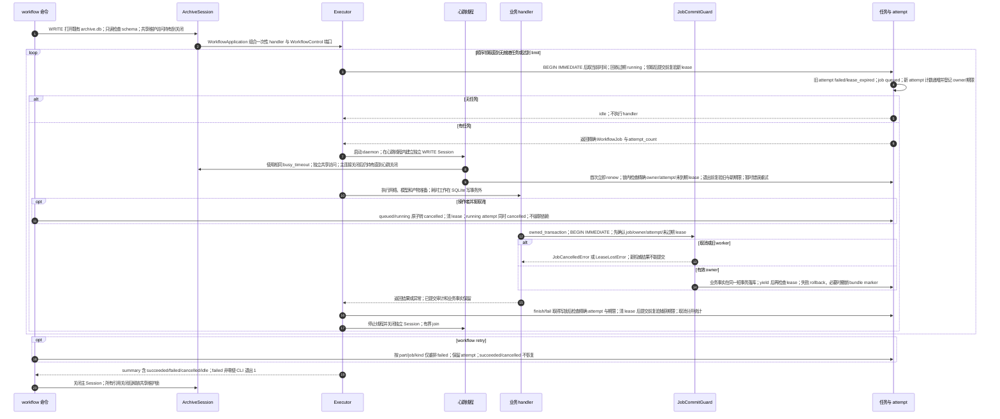

# 任务认领、共享提交保护、心跳与取消重试

源码基线：`4f073318c944add37417416155845e55247f9bc1`；核对日期：2026-10-11（Asia/Hong_Kong）。

[交互时序图](04-lease-cancel-retry.html) · [Archify 规格](04-lease-cancel-retry.json) · [全部时序图](../architecture-sequences.md)

## 调用顺序与条件分支

## 边界与恢复

- 维护锁排除快照/恢复，SQLite 写锁串行化取消和权威提交；两个锁职责独立。普通工作者共享维护访问，互不全局串行化。
- 网络、GPU、模型调用采用协作取消；当前 run 不保证立即终止所有在途请求。已完成真实响应审计允许保留。
- 结果事实和 executor 终态仍为独立事务；崩溃可能留下业务结果已存而 job running，依靠幂等事实与租约回收恢复。
- 连接引用计数支持独立连接任意关闭顺序；失败的跨线程 close 不释放仍存活连接的维护访问。心跳仍在 I/O 时保留自己的访问。

## 源码证据

- [src/bili_asr/cli/workflow.py:241](../../src/bili_asr/cli/workflow.py#L241)：_execute_workflow。
- [src/bili_asr/archive_session.py:106](../../src/bili_asr/archive_session.py#L106)：ArchiveSession.open。
- [src/bili_asr/archive_maintenance.py:84](../../src/bili_asr/archive_maintenance.py#L84)：archive_access。
- [src/bili_asr/workflow.py:128](../../src/bili_asr/workflow.py#L128)：WorkflowExecutor.run。
- [src/bili_asr/services/workflow_application.py:103](../../src/bili_asr/services/workflow_application.py#L103)：WorkflowApplication.run。
- [src/bili_asr/workflow.py:285](../../src/bili_asr/workflow.py#L285)：_LeaseHeartbeat._run。
- [src/bili_asr/storage/workflow.py:54](../../src/bili_asr/storage/workflow.py#L54)：WorkflowRepository.open_lease_repository。
- [src/bili_asr/workflow_runtime.py:411](../../src/bili_asr/workflow_runtime.py#L411)：ArchiveWorkflowHandlers.publish。
- [src/bili_asr/editorial_runtime.py:74](../../src/bili_asr/editorial_runtime.py#L74)：EditorialWorkflowHandlers.render。
- [src/bili_asr/storage/job_commit.py:13](../../src/bili_asr/storage/job_commit.py#L13)：JobCommitGuard。
- [src/bili_asr/storage/workflow.py:262](../../src/bili_asr/storage/workflow.py#L262)：WorkflowRepository.claim。
- [src/bili_asr/storage/workflow.py:364](../../src/bili_asr/storage/workflow.py#L364)：WorkflowRepository.cancel。
- [src/bili_asr/storage/workflow.py:814](../../src/bili_asr/storage/workflow.py#L814)：WorkflowRepository._terminal。

## 提交期限补充

实际字幕/ASR repository 接受共享 JobCommitGuard 的完整事务上下文，正文、模型、coverage/evidence 与成功 attempt 在提交前再次校验 owner/attempt/expiry。事务内到期全部回滚；失败 run 的审计收尾仍允许保存。旧 callback API 也在事务退出时复验。认领在 BEGIN IMMEDIATE 返回后采样时间并在提交前检查新租约；续约拒绝精确到期，并在写入后复验旧截止和新截止两者较早值，不能靠慢写续活已经到期的旧租约；finish/fail 清空 lease 后以捕获的截止再作提交前检查。等待写锁不消耗随后发放的新租约，也不能靠旧时间复活到期任务。

## claim 前准入

监督路径先 peek 准确 candidate，在未认领状态完成输入 pin、精确恢复、空间预留及 GPU prepare；再以 expected_candidate claim。输入不可用不消耗 attempt；candidate 改变重新选择。详见 [19](19-persistent-asr.md)、[24](24-artifact-storage.md)。
