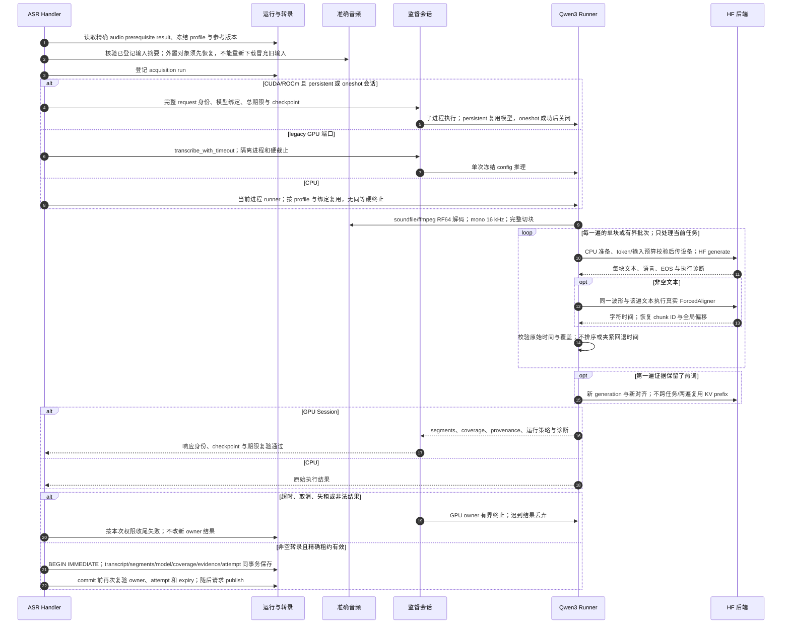

# ASR 执行分派、冻结输入与受保护结果

源码基线：`4f073318c944add37417416155845e55247f9bc1`；核对日期：2026-10-11（Asia/Hong_Kong）。

[交互图](07-asr-runtime.html) · [JSON 规格](07-asr-runtime.json) · [时序索引](../architecture-sequences.md)

## 边界与恢复

- 生产 CLI 默认 supervised persistent；CPU、legacy 与 oneshot 是不同执行边界。准备与 warmup 在 claim 前进行，见 19。
- 批处理、attention/cache/compile 为显式 profile 扩展；默认批大小 1，见 26。诊断 wall-time 不是 GPU kernel 利用率。
- 同内容去重仍保存本次 ASR evidence。失败中间块不因此成为持久转录。

## 源码证据

- [src/bili_asr/workflow_runtime.py:279](../../src/bili_asr/workflow_runtime.py#L279)：ArchiveWorkflowHandlers.local_asr。
- [src/bili_asr/storage/transcripts.py:331](../../src/bili_asr/storage/transcripts.py#L331)：TranscriptRepository.record_local_transcript。
- [src/bili_asr/services/workflow_audio_access.py:1](../../src/bili_asr/services/workflow_audio_access.py#L1)：模块定义。
- [src/bili_asr/asr/session.py:154](../../src/bili_asr/asr/session.py#L154)：AsrInferenceSession。
- [src/bili_asr/asr/runner.py:214](../../src/bili_asr/asr/runner.py#L214)：ASRRunner。
- [src/bili_asr/asr/backend.py:1](../../src/bili_asr/asr/backend.py#L1)：模块定义。
