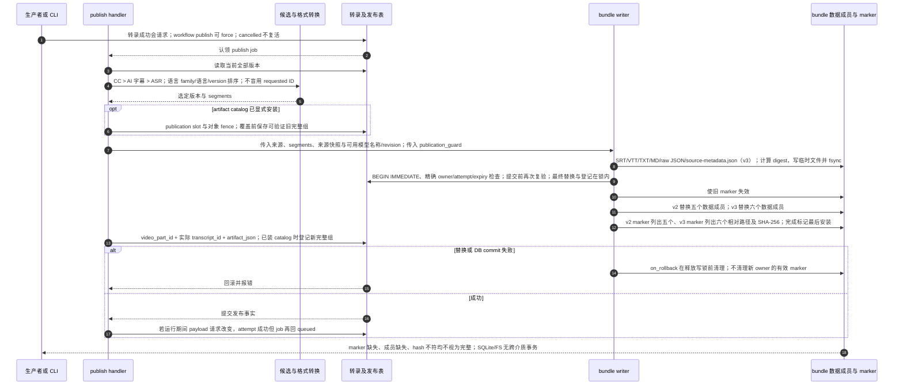

# 择优转录、bundle v2/v3 发布与完成标记

源码基线：`4f073318c944add37417416155845e55247f9bc1`；核对日期：2026-10-11（Asia/Hong_Kong）。

[交互时序图](08-transcript-bundle.html) · [Archify 规格](08-transcript-bundle.json) · [全部时序图](../architecture-sequences.md)

## 调用顺序与条件分支

## 边界与恢复

- 转录 bundle 与获人工批准的 publication release 是两个独立发布域。
- archive.write_archive 支持较丰富的 ASR 参数；当前 workflow.publish 只传已观察到的子集，数据库证据用 workflow asr-evidence 查看。v3 raw JSON 保留转录/ASR 证据，不重复来源元数据；`bundle.md` 由规范 sidecar 和转录内容生成。
- 受保护写锁解决合作取消/抢占竞态；不能保证掉电后数据库与文件恰好一次一致。

## 源码证据

- [src/bili_asr/storage/workflow.py:651](../../src/bili_asr/storage/workflow.py#L651)：WorkflowRepository.request_publication。
- [src/bili_asr/workflow_runtime.py:411](../../src/bili_asr/workflow_runtime.py#L411)：ArchiveWorkflowHandlers.publish。
- [src/bili_asr/services/transcript_projection.py:106](../../src/bili_asr/services/transcript_projection.py#L106)：ordered_candidates。
- [src/bili_asr/services/transcript_projection.py:151](../../src/bili_asr/services/transcript_projection.py#L151)：writer_segments。
- [src/bili_asr/storage/workflow.py:814](../../src/bili_asr/storage/workflow.py#L814)：WorkflowRepository._terminal。
- [src/bili_asr/archive.py:888](../../src/bili_asr/archive.py#L888)：write_archive。
- [src/bili_asr/archive.py:405](../../src/bili_asr/archive.py#L405)：_publish_bundle。
- [src/bili_asr/archive.py:253](../../src/bili_asr/archive.py#L253)：archive_bundle_complete。
- [src/bili_asr/services/artifact_groups.py:1](../../src/bili_asr/services/artifact_groups.py#L1)：模块定义。

## 本次边界修复

生产和消费统一复用 `transcript_selection`。当前 preferred 与实际 published 分别展示，尚未发布的新偏好不会改写归档正文。发布事实的 published_at 是以墙钟秒为底的 part 内单调提交时间；同秒重发旧行也成为最新事实。短突发可能领先墙钟秒。共享 JobCommitGuard 在事务开始及提交前验证精确租约，失败时先使 marker 失效。
