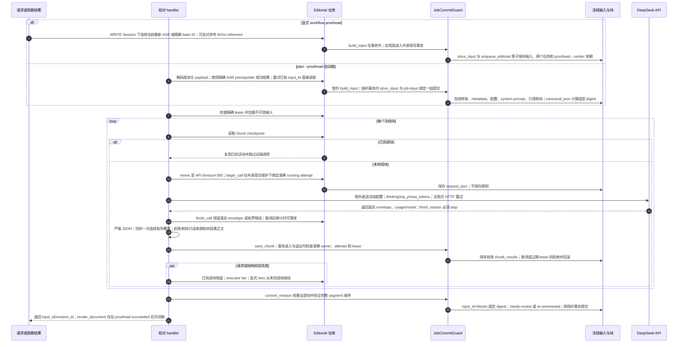

# 冻结 AI 输入、共享提交保护与逐块续跑

源码基线：`4f073318c944add37417416155845e55247f9bc1`；核对日期：2026-10-11（Asia/Hong_Kong）。

[交互时序图](09-ai-proofread.html) · [Archify 规格](09-ai-proofread.json) · [全部时序图](../architecture-sequences.md)

## 调用顺序与条件分支

## 边界与恢复

- build_input 在事务外构建冻结内容；显式请求的 store_input、两个任务和依赖边由应用层共事务保存，失败全部回滚。自动链的 store_input 与 job-input 绑定同样共用一次保护事务。
- Workflow 与 EditorialRepository 注入同一 JobCommitGuard；准确 attempt/owner/lease 在短写事务两端校验，不再各自实现租约保护逻辑。
- 来源覆盖证明结构追溯，不能证明模型语义保真；数字、专名、否定、立场仍需人工审核。供应商已收请求而本地未存时，retry 可能重复计费。
- canonical_json 是共享纯序列化契约；editorial.canonical/digest 保留兼容导出，持久 JSON、digest 和既有 schema 未改变。

## 源码证据

- [src/bili_asr/services/workflow_application.py:74](../../src/bili_asr/services/workflow_application.py#L74)：WorkflowApplication.proofread。
- [src/bili_asr/workflow_payloads.py:77](../../src/bili_asr/workflow_payloads.py#L77)：decode_job_payload。
- [src/bili_asr/editorial_runtime.py:40](../../src/bili_asr/editorial_runtime.py#L40)：EditorialWorkflowHandlers.proofread。
- [src/bili_asr/storage/editorial.py:171](../../src/bili_asr/storage/editorial.py#L171)：EditorialRepository.freeze_job_input。
- [src/bili_asr/storage/editorial.py:206](../../src/bili_asr/storage/editorial.py#L206)：EditorialRepository.begin_call。
- [src/bili_asr/storage/editorial.py:219](../../src/bili_asr/storage/editorial.py#L219)：EditorialRepository.finish_call。
- [src/bili_asr/storage/job_commit.py:13](../../src/bili_asr/storage/job_commit.py#L13)：JobCommitGuard。
- [src/bili_asr/storage/editorial.py:135](../../src/bili_asr/storage/editorial.py#L135)：EditorialRepository.store_input。
- [src/bili_asr/storage/editorial.py:234](../../src/bili_asr/storage/editorial.py#L234)：EditorialRepository.save_chunk。
- [src/bili_asr/storage/editorial.py:239](../../src/bili_asr/storage/editorial.py#L239)：EditorialRepository.commit_revision。
- [src/bili_asr/deepseek.py:38](../../src/bili_asr/deepseek.py#L38)：DeepSeekClient.complete。
- [src/bili_asr/deepseek.py:61](../../src/bili_asr/deepseek.py#L61)：parse_response。

## 当前冻结与失败恢复

v1/v2 输入按持久版本分派，普通 proofread 优先复用可验证冻结输入；refresh-input 显式建立新快照。结构性重复 ASR 输入在模型请求前失败；failed proofread 的新配置修复保留旧证据，见 [30](30-editorial-repair.md)。
