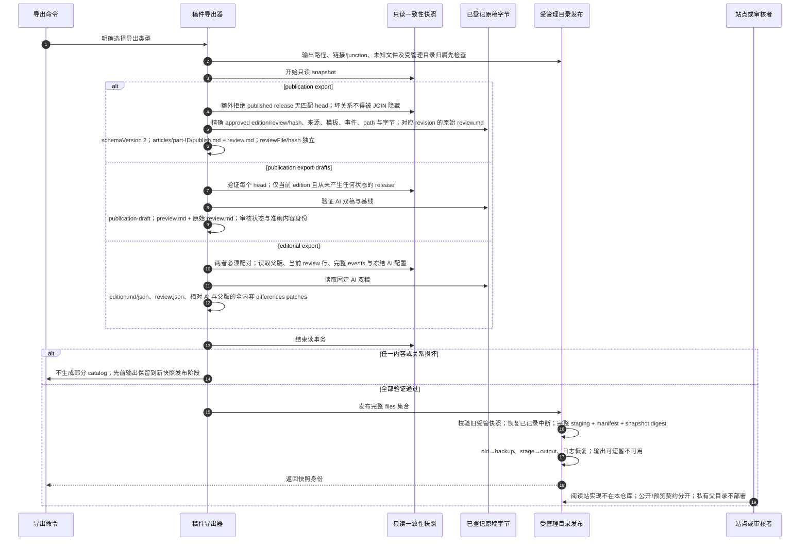

# 公开、未发布预览与私有审阅三种导出

源码基线：`4f073318c944add37417416155845e55247f9bc1`；核对日期：2026-10-11（Asia/Hong_Kong）。

[交互时序图](12-reader-private-export.html) · [Archify 规格](12-reader-private-export.json) · [全部时序图](../architecture-sequences.md)

## 调用顺序与条件分支

## 边界与恢复

- 读者 review.md 是 AI 初稿的原文与疑点参照，不是人工审核记录；编辑后的正文可能与它不同。
- 公开/预览均不包含 actor、审核 events、请求配置与私有差异；私有包始终另行显式导出。
- withdraw 修改 DB head；已导出或已部署副本需要再次导出和刷新，本仓库不自动发布远端站点。

## 源码证据

- [src/bili_asr/cli/publication.py:63](../../src/bili_asr/cli/publication.py#L63)：_cmd_publication。
- [src/bili_asr/cli/editorial.py:14](../../src/bili_asr/cli/editorial.py#L14)：_cmd_editorial。
- [src/bili_asr/publication_export.py:91](../../src/bili_asr/publication_export.py#L91)：export_publications。
- [src/bili_asr/publication_export.py:148](../../src/bili_asr/publication_export.py#L148)：export_publication_drafts。
- [src/bili_asr/publication_export.py:276](../../src/bili_asr/publication_export.py#L276)：export_editorial。
- [src/bili_asr/publication_export.py:37](../../src/bili_asr/publication_export.py#L37)：_read_snapshot。
- [src/bili_asr/publication.py:109](../../src/bili_asr/publication.py#L109)：verify_release。
- [src/bili_asr/publication.py:1](../../src/bili_asr/publication.py#L1)：模块定义。
- [src/bili_asr/export_snapshot.py:429](../../src/bili_asr/export_snapshot.py#L429)：replace_snapshot。
- [src/bili_asr/publication_export.py:1](../../src/bili_asr/publication_export.py#L1)：模块定义。

## 本次边界修复

CLI 使用 ArchiveSession 的 READ/WRITE 与 MANUSCRIPT 契约管理连接及维护锁；纯内容与身份规则由 publication_content / publication_identity / canonical_json 承载，历史字节身份保持原算法。读取快照经 storage.publication 的公开读/校验接口，不导入出版编排函数。

## 当前版本与消费

content v1/v2、publish/ai 模板按保存身份分派，导出先做 wheel 内离线 Schema 再核验真实引用/文件/hash。普通公开/预览与迁移 origin profile 分开；保留旧正文和来源补充见 [28](28-preserved-body.md)，可选编辑系列见 [29](29-publication-series.md)。启用 catalog 后准确历史组可以显式恢复，不能用当前文件槽位代替旧版本。
