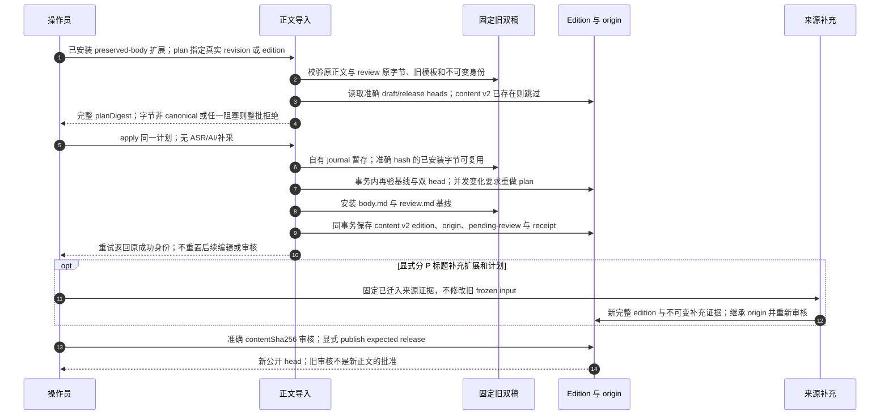

# 保留旧正文、来源补充与重新审核

源码基线：`4f073318c944add37417416155845e55247f9bc1`；核对日期：2026-10-11（Asia/Hong_Kong）。

[交互图](28-preserved-body.html) · [JSON 规格](28-preserved-body.json) · [时序索引](../architecture-sequences.md)

## 边界与恢复

- legacy-frozen-facts-v1 与标题补充是独立版本政策；未知旧来源字段保持 null/unobserved。
- 正文改动后 origin relation 为 derived，等于基线为 preserved；快照保留全部原参照。
- 迁移稿使用 universal-origin-v1：catalog v3/origins v1/manifest v2；普通 manifest v1 不可伪装迁移稿。

## 源码证据

- [src/bili_asr/cli/publication.py:1](../../src/bili_asr/cli/publication.py#L1)：模块定义。
- [src/bili_asr/services/preserved_body_import.py:132](../../src/bili_asr/services/preserved_body_import.py#L132)：plan_preserved_body_import。
- [src/bili_asr/services/preserved_body_import.py:237](../../src/bili_asr/services/preserved_body_import.py#L237)：apply_preserved_body_import。
- [src/bili_asr/services/import_staging.py:1](../../src/bili_asr/services/import_staging.py#L1)：模块定义。
- [src/bili_asr/storage/import_origins.py:1](../../src/bili_asr/storage/import_origins.py#L1)：模块定义。
- [src/bili_asr/services/source_supplement.py:1](../../src/bili_asr/services/source_supplement.py#L1)：模块定义。
