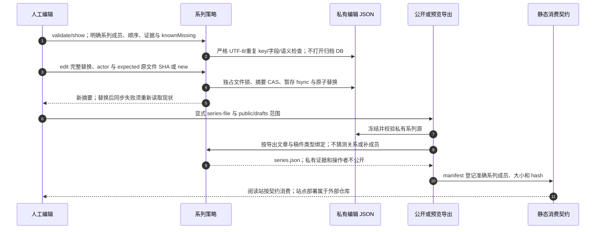

# 编辑系列 CAS、导出绑定与静态消费

源码基线：`4f073318c944add37417416155845e55247f9bc1`；核对日期：2026-10-11（Asia/Hong_Kong）。

[交互图](29-publication-series.html) · [JSON 规格](29-publication-series.json) · [时序索引](../architecture-sequences.md)

## 边界与恢复

- 系列是独立编辑元数据，不改既有正文、edition/release 或来源事实。
- 编号间隔不自动表示缺失，只有编辑确认的 knownMissing 可输出。

## 源码证据

- [src/bili_asr/cli/publication.py:1](../../src/bili_asr/cli/publication.py#L1)：模块定义。
- [src/bili_asr/publication_series.py:133](../../src/bili_asr/publication_series.py#L133)：edit_series。
- [src/bili_asr/publication_series.py:174](../../src/bili_asr/publication_series.py#L174)：project_series。
- [src/bili_asr/publication_series.py:48](../../src/bili_asr/publication_series.py#L48)：read_series_with_sha256。
- [src/bili_asr/publication_export.py:1](../../src/bili_asr/publication_export.py#L1)：模块定义。
- [src/bili_asr/contracts/schemas/publication-series.schema.json:1](../../src/bili_asr/contracts/schemas/publication-series.schema.json#L1)：模块定义。
